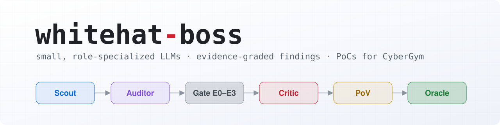
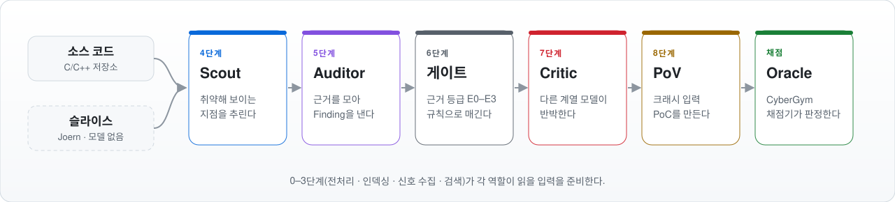

<div align="center">

<picture>
  <source media="(prefers-color-scheme: dark)" srcset="docs/assets/banner-dark.svg">
  
</picture>

### 소형 LLM 여러 개를 역할별로 조합해 C/C++ 취약점을 찾아내는 Multi-Agent 하네스

<a href="LICENSE"></a>  <a href="https://github.com/sunblaze-ucb/cybergym"></a> 

[English](README.md) · **한국어**

[빠른 시작](#빠른-시작-gpu-없이) · [파이프라인](#파이프라인) · [실제 과제 돌리기](#실제-과제-돌리기) · [상태와 한계](#상태와-한계) · [문서](#문서)

</div>

---

C/C++ 소스에서 메모리 취약점을 찾고, 근거를 검증하고, 크래시 입력 PoC를 만들어 채점기에 제출하는
데까지를 자동화하는 하네스다. 큰 단일 모델 하나에 맡기지 않고, 역할이 다른 소형 LLM을 파이프라인
단계마다 바꿔 세운다. 분석에 넣을 코드 조각은 모델을 쓰지 않는 Joern 슬라이서가 미리 만든다.

평가는 [CyberGym](https://github.com/sunblaze-ucb/cybergym) 벤치마크로 한다. 실제 오픈소스 프로젝트의
알려진 취약점을 재현하는 과제 모음이다.

> [!NOTE]
> 아직 유효한 점수를 낸 적은 없다 — [상태와 한계](#상태와-한계)를 먼저 본다. README 밖의 문서와 CLI 출력은 한국어다.

## 한눈에 보기

<picture>
  <source media="(prefers-color-scheme: dark)" srcset="docs/assets/pipeline-ko-dark.svg">
  
</picture>

| 역할 | 하는 일 |
| --- | --- |
| 🔭 **Scout** | 소스에서 취약해 보이는 지점을 후보로 추린다 |
| 🔍 **Auditor** | 후보 코드를 읽고 취약점인지 근거를 모아 Finding을 낸다 |
| ⚖️ **Critic** | 다른 계열 모델로 그 Finding을 반박한다. 반박을 버텨야 등급이 오른다 |
| 💥 **PoV** | 살아남은 Finding에서 크래시 입력 PoC를 만들어 채점기에 제출한다 |
| 🔪 **슬라이서** | 하네스 밖에서 미리 돌아 분석할 코드 조각 `slices.json`을 만든다 — [규칙](docs/slicer-README.md) |

실측과 설계의 단일 출처는 코드와 `config/`다. 문서는 그 요약이다. 규약은 [CLAUDE.md](CLAUDE.md)를 본다.

## 파이프라인

입력은 소스 디렉터리(`--target`)나 CyberGym 과제 번들(`--task-dir`)이다. 펌웨어 이미지 추출은
아직 없다([architecture.md](docs/architecture.md) §3). 0단계부터 9단계까지 순서대로 돈다.
각 단계는 순수 함수와 스키마로 되어 있고, 상태기계가 실행 순서와 체크포인트를 관리한다.

| 단계 | 이름 | 하는 일 | 산출물 |
| --- | --- | --- | --- |
| 0 | 전처리 | 파일 타입을 분류하고 파일마다 해시를 부여한다 | Artifact 목록 |
| 1 | 인덱싱 | tree-sitter로 심볼과 호출 그래프를 뽑는다. 오프라인 Joern 슬라이서가 후보 코드 조각을 만든다 | 코드 인덱스, `slices.json` |
| 2 | 신호 수집 | Semgrep, clang-tidy, 빌드 프로브, 새니타이저 로그로 정적 신호를 모은다 | Evidence 목록 |
| 3 | 검색 | 넓게 수집한 뒤 임베딩과 리랭커로 재선별한다. 실서빙 기본값은 꺼짐이다 | ContextCapsule |
| 4 | Scout | 취약 후보를 추리고 위험 카테고리를 매긴다 | Candidate 목록 |
| 5 | Auditor | source에서 sink까지의 흐름, 메모리 수명, 경계 조건을 분석하고 근거 초안을 쓴다 | Finding 초안 |
| 6 | 근거 게이트 | 결정론 규칙으로 근거 등급을 매긴다. 애매한 경우에도 모델을 부르지 않는다 | 승격, 보류, 폐기 |
| 7 | Critic | 다른 계열 모델이 reachability, aliasing, guard를 들어 반박한다 | 반박 또는 지지 |
| 8 | 도구 검증 | Docker 안에서 빌드, 새니타이저, PoC를 실행하고 채점기에 제출한다 | 실행 로그 |
| 9 | 리포트 | 규칙 기반으로 중복을 제거하고 리포트를 만든다 | 리포트 |

### 근거 등급

Finding은 모델이 매긴 점수가 아니라 쌓인 근거로만 올라간다. 등급 E0부터 E4까지 있고 그에 따라
상태가 바뀐다.

| 등급 | 뜻 | 상태 |
| --- | --- | --- |
| E0 | 근거가 부족하다 | `queued` |
| E1 | 정적 신호나 위치 근거가 있다 | `hypothesized` |
| E2 | source와 sink 경로가 있고 그래프 근거가 있으며 막는 미해결 근거가 없다 | Critic 대상 |
| E3 | E2를 만족하고 Critic 반박을 버티며 재현 명세가 있다 | `validated` |
| E4 | 도구 실행 로그가 있고 종료 코드가 0이 아니다. 대용 지표이지 재현 확정이 아니다 | `proven` — 최종 판정은 채점기가 한다 |

## 핵심 설계

<table>
<tr>
<td width="33%" valign="top">

<b>🔁 단계 단위 교대 서빙</b><br>
역할별 소형 모델을 GPU 하나에 다 올리지 않고, 단계가 바뀔 때 서버를 끄고 다음 모델을 켠다.

</td>
<td width="33%" valign="top">

<b>🧾 근거로만 승격한다</b><br>
모델 점수가 아니라 게이트와 Critic과 도구 결과가 Finding을 올린다.

</td>
<td width="33%" valign="top">

<b>📏 실측 ≠ 추정</b><br>
<code>benchmark: 0</code>과 <code>checksum: 0</code>은 빈 값이 아니라 아직 안 쟀다는 표시다.

</td>
</tr>
<tr>
<td width="33%" valign="top">

<b>🔪 모델 없는 슬라이싱</b><br>
슬라이싱에는 모델도 GPU도 쓰지 않는다. 다만 Joern 데이터플로는 같은 입력에도 다른 경로를 고를 수 있어, 다시 돌린 결과가 늘 같지는 않다(<a href="docs/slicer-README.md">slicer-README</a>).

</td>
<td width="33%" valign="top">

<b>🧪 Fake ↔ 실서빙 프로필</b><br>
<code>dev_fake</code>는 모든 역할이 Fake라 GPU 없이 끝까지 돈다.

</td>
<td width="33%" valign="top">

<b>🗂️ 호출을 분리해 기록</b><br>
모델 호출 <code>model_call</code>과 검색 호출 <code>retrieval_call</code>을 trace에 따로 남긴다.

</td>
</tr>
</table>

## 저장소 구조

| 경로 | 내용 |
| --- | --- |
| `src/` | 오케스트레이터, CLI, 어댑터, 상태기계 |
| `config/` | 모델 레지스트리, 프로필, 예산, 장비별 서빙 설정 |
| `tools/slicer/` | 오프라인 Joern 슬라이서. 표준 라이브러리만 쓴다 |
| `prompts/` | 역할별 프롬프트 |
| `eval/` | 데이터 누출 검사 유틸과 CyberGym 과제 받기 안내. 데이터셋 자체는 들어 있지 않다 |
| `docs/` | 아키텍처, 결정 ADR, 결함 D와 R, 실험 기록, 조사 |

## 요구 사항

| 무엇 | 언제 필요한가 |
| --- | --- |
| **Python 3.11.4 이상** | 항상 — `pip install -r requirements.txt` |
| **Docker** | 도구 실행과 채점 |
| **Joern 4.0.x · JDK 21** | 슬라이싱을 할 때만 |
| **GPU · vLLM** | 역할 모델을 실제로 서빙할 때만 |

## 빠른 시작: GPU 없이

`dev_fake` 프로필은 모든 역할을 Fake로 두어 GPU 없이 0단계부터 9단계까지 배관을 끝까지
돌려 본다. 모델이 Fake라 결과는 역량 측정이 아니다.

```bash
pip install -r requirements.txt

# 환경 점검
python -m src.cli doctor --profile dev_fake

# 과제 번들을 받는다. 이 저장소는 CyberGym 데이터를 담지 않는다 — HF에서 직접 받는다
python tools/cybergym_task.py arvo:1065 --out eval/datasets/arvo-1065

# 그 번들로 한 번 완주시킨다. --task-work-dir는 번들을 풀 빈 디렉터리다
python -m src.cli run --profile dev_fake \
  --task-dir eval/datasets/arvo-1065 --task-work-dir path/to/empty-dir
```

테스트:

```bash
python -m pytest -q
```

## 실제 과제 돌리기

도구 이미지, 슬라이싱, 모델 서빙, 채점 준비, 실행 다섯 단계다.

<details>
<summary><b>1) 도구 이미지</b> — 2·8단계 도구가 이 안에서 돈다</summary>

```bash
# semgrep · clang-tidy · 빌드 · gdb 등
docker build -t harness-tools:v3 tools/harness-tools/
```

룰셋 고정과 Slurm 클러스터용 Singularity 이관은 [tools/README.md](tools/README.md)를 본다.

</details>

<details>
<summary><b>2) 슬라이싱</b> — 번들을 푼 디렉터리를 <code>--repo</code>로 준다</summary>

`--repo`에는 `src-vul/`이 아니라 그 부모(번들을 푼 디렉터리)를 준다. run이 슬라이스 경로를 그
디렉터리 기준으로 찾는다.

```bash
mkdir -p /work/task && tar -xzf eval/datasets/arvo-1065/repo-vul.tar.gz -C /work/task
./joern-cli/joern -J-Xss64m -J-Xmx16g --server --server-host 127.0.0.1 --server-port 16242 &
python tools/slicer/slicer.py --repo /work/task \
  --joern-endpoint http://127.0.0.1:16242 \
  --joern-version-command ./joern-cli/joern \
  --out slices.json
```

</details>

<details>
<summary><b>3) 모델 서빙</b> — 역할 모델을 vLLM으로 띄운다</summary>

모델과 기동 인자는 `config/models.yaml`과 `config/serving/<device>.yaml`에 있다. `--device` 값은 그
파일 이름이다(`atom` · `vastai` · `vastai-remote`).

</details>

<details>
<summary><b>4) 채점 준비</b> — 카나리 보고서와 채점 서버 키</summary>

채점기(CyberGym 저자 서버)는 조작자가 따로 띄운다. 그 장비가 sanitizer를 제대로 돌리는지 카나리로
재 두고, 그 보고서가 없거나 pass가 아니면 run이 제출 전에 거부한다. 채점기 왕복은
[2026-10-02 보고서](docs/experiments/harness/2026-10-02-cybergym-oracle-roundtrip-win11wsl.md)를 본다.

```bash
python tools/oracle_canary.py arvo:1065 --out canary.json
export CYBERGYM_API_KEY=<채점 서버 키>
```

</details>

<details open>
<summary><b>5) 실행</b> — 실서빙 프로필로 채점기까지</summary>

실서빙 프로필은 `--condition` 없이 시작하지 않는다.

```bash
python -m src.cli run --profile harness_pool --device vastai-remote \
  --condition <조건 라벨> \
  --task-dir eval/datasets/arvo-1065 --task-work-dir /work/run-empty \
  --slices slices.json \
  --oracle-submit --oracle-server http://127.0.0.1:8666 --oracle-canary canary.json
```

</details>

서브커맨드는 `doctor`, `preflight`, `estimate`, `run`, `bench`, `gc` 다. 각 명령의 플래그는
`python -m src.cli <명령> -h` 로 본다.

## 상태와 한계

> [!WARNING]
> **유효한 점수는 아직 없다.** 채점기가 최종 PoC로 집계한 것이 아직 없다.

- [2026-10-08 run](docs/experiments/harness/2026-10-08-first-real-serving-run-arvo1065-vastai-remote.md)에서는
  6바이트 PoC가 취약 빌드를 크래시했지만(`vul_exit_code 77`) 하네스가 그것을 최종 PoC로 지정하지 않아
  점수가 0이었다([#549](https://github.com/0xM1yu/whitehat-boss/issues/549)).
- [2026-10-12 run](docs/experiments/harness/2026-10-12-serving-run-arvo1065-vastai-remote.md)은 PoC 4건을
  제출했으나 4건 모두 `vul_exit_code 0`이었다(§5).
- 가장 최근 [2026-10-16 run](docs/experiments/harness/2026-10-16-serving-run-arvo1065-vastai-remote.md)은
  5단계에서 비정상 종료했다. run 기록 전체는 [docs/experiments/](docs/experiments/README.md)에 있다.
- **모델 레지스트리의 `benchmark`는 전부 0(미실측)이고, 실모델 6개 중 3개는 `checksum`도
  자리표시자(0)다**(2026-10-17 `config/models.yaml` 기준). 모델 선정 근거는 실험팀 내부 자료이고
  이 저장소의 실측이 아니다.
- **펌웨어 입력은 아직 없다.** 바이너리·펌웨어 분석 경로는 설계에만 있다.

> [!CAUTION]
> **이 도구는 크래시 입력을 만든다.** 허가받은 대상에만 쓴다 — [SECURITY.ko.md](SECURITY.ko.md).

## 문서

| 알고 싶은 것 | 문서 |
| --- | --- |
| 전체 구조, 단계별 책임, 근거 등급 | [docs/architecture.md](docs/architecture.md) |
| 역할별 실행 계약과 프롬프트 규약 | [docs/agent-contracts.md](docs/agent-contracts.md) |
| 지표 정의와 조건 간 비교 규칙 | [docs/evaluation.md](docs/evaluation.md) |
| 슬라이서 분석 규칙 Case A와 Case B | [docs/slicer-README.md](docs/slicer-README.md) |
| 되돌리기 어려운 결정 ADR | [docs/decisions/](docs/decisions/) |
| 미해결 결함과 리스크 | [docs/open-questions.md](docs/open-questions.md) |
| 하네스를 돌린 run 기록 | [docs/experiments/](docs/experiments/README.md) |

## 팀

[WhiteHat School](https://www.whsedu.kr/) 4기 2차 프로젝트 — **Team 화햇대장**.
팀 구성은 [팀 소개](https://github.com/whitehatboss4/whitehatboss4)에 있다.

## 라이선스

[MIT](LICENSE). 평가 데이터셋인 CyberGym 과제와 정답은 이 저장소에 넣지 않는다. 과제는 Hugging Face에서
직접 받는다([eval/cybergym/README.md](eval/cybergym/README.md)).
