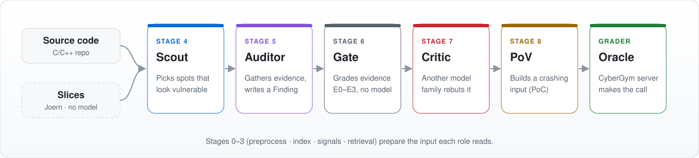

<div align="center">

<picture>
  <source media="(prefers-color-scheme: dark)" srcset="docs/assets/banner-dark.svg">
  
</picture>

### A multi-agent harness that pairs small, role-specialized LLMs to find C/C++ vulnerabilities

<a href="LICENSE"></a>  <a href="https://github.com/sunblaze-ucb/cybergym"></a> 

**English** · [한국어](README.ko.md)

[Quick start](#quick-start-no-gpu) · [Pipeline](#pipeline) · [Running a real task](#running-a-real-task) · [Docs](#docs)

</div>

---

whitehat-boss automates the path from C/C++ source to a submitted proof of concept: it looks for memory
vulnerabilities, checks the evidence, builds a crashing input (PoC), and submits it to a grader. Instead of
handing everything to one large model, it puts a different small LLM in each pipeline stage. The code
fragments the models analyze are prepared ahead of time by a Joern slicer that uses no model at all.

It is evaluated on [CyberGym](https://github.com/sunblaze-ucb/cybergym), a set of tasks that reproduce known
vulnerabilities in real open-source projects.

> [!NOTE]
> Everything outside the README (`docs/`, code comments, CLI output) is in Korean.

## At a glance

<picture>
  <source media="(prefers-color-scheme: dark)" srcset="docs/assets/pipeline-en-dark.svg">
  
</picture>

| Role | What it does |
| --- | --- |
| 🔭 **Scout** | Narrows the source down to spots that look vulnerable |
| 🔍 **Auditor** | Reads the candidate code and gathers evidence for a Finding |
| ⚖️ **Critic** | Tries to rebut the Finding with a model from a different family. A Finding only moves up if it survives |
| 💥 **PoV** | Builds a crashing input from surviving Findings and submits it to the grader |
| 🔪 **Slicer** | Runs outside the harness beforehand and writes the code fragments to analyze, `slices.json` — [rules](docs/slicer-README.md) |

The code and `config/` are the single source of truth for both measurements and design; the docs summarize
them. Project conventions are in [CLAUDE.md](CLAUDE.md).

## Pipeline

The input is a source directory (`--target`) or a CyberGym task bundle (`--task-dir`). Firmware image
extraction does not exist yet ([architecture.md](docs/architecture.md) §3). Stages 0 through 9 run in order.
Each stage is a pure function with a schema, and a state machine manages execution order and checkpoints.

| Stage | Name | What it does | Output |
| --- | --- | --- | --- |
| 0 | Preprocess | Classifies file types and hashes every file | Artifact list |
| 1 | Index | Extracts symbols and the call graph with tree-sitter. The offline Joern slicer produces candidate code fragments | Code index, `slices.json` |
| 2 | Signals | Collects static signals from Semgrep, clang-tidy, a build probe, and sanitizer logs | Evidence list |
| 3 | Retrieval | Collects broadly, then re-ranks with an embedding model and a reranker. Off by default in real serving | ContextCapsule |
| 4 | Scout | Picks vulnerability candidates and assigns a risk category | Candidate list |
| 5 | Auditor | Analyzes source-to-sink flow, memory lifetime, and boundary conditions, and drafts the evidence | Finding draft |
| 6 | Evidence gate | Grades the evidence with deterministic rules. It does not call a model, even in ambiguous cases | Promote, hold, or drop |
| 7 | Critic | A model from a different family rebuts using reachability, aliasing, and guards | Rebuttal or support |
| 8 | Tool verification | Builds, runs sanitizers, runs the PoC inside Docker, and submits to the grader | Execution logs |
| 9 | Report | Deduplicates by rule and writes the report | Report |

### Evidence grades

A Finding moves up only on accumulated evidence, never on a score a model gave it. There are five grades,
E0 to E4, and each one maps to a state.

| Grade | Meaning | State |
| --- | --- | --- |
| E0 | Not enough evidence | `queued` |
| E1 | There is a static signal or location evidence | `hypothesized` |
| E2 | There is a source-to-sink path, graph evidence, and no blocking unresolved evidence | Goes to the Critic |
| E3 | Meets E2, survives the Critic's rebuttal, and has a reproduction spec | `validated` |
| E4 | A tool execution log exists and the exit code is non-zero. A proxy, not a confirmed reproduction | `proven` — the grader makes the final call |

## Design principles

<table>
<tr>
<td width="33%" valign="top">

<b>🔁 Stage-by-stage swapping</b><br>
Rather than fitting every role's model on one GPU, the server is shut down and the next model started when the stage changes.

</td>
<td width="33%" valign="top">

<b>🧾 Promotion only on evidence</b><br>
The gate, the Critic, and tool results promote a Finding — not a model's score.

</td>
<td width="33%" valign="top">

<b>📏 Measured ≠ estimated</b><br>
<code>benchmark: 0</code> and <code>checksum: 0</code> are not empty values; they mean “not measured yet”.

</td>
</tr>
<tr>
<td width="33%" valign="top">

<b>🔪 Model-free slicing</b><br>
Slicing uses neither a model nor a GPU. Joern's data flow can still pick different paths for the same input, so a re-run does not always match (<a href="docs/slicer-README.md">slicer-README</a>).

</td>
<td width="33%" valign="top">

<b>🧪 Fake ↔ real profiles</b><br>
<code>dev_fake</code> makes every role a Fake, so the whole pipeline runs end to end without a GPU.

</td>
<td width="33%" valign="top">

<b>🗂️ Separate call logs</b><br>
Model calls (<code>model_call</code>) and retrieval calls (<code>retrieval_call</code>) get their own trace records.

</td>
</tr>
</table>

## Repository layout

| Path | Contents |
| --- | --- |
| `src/` | Orchestrator, CLI, adapters, state machine |
| `config/` | Model registry, profiles, budgets, per-device serving settings |
| `tools/slicer/` | The offline Joern slicer. Standard library only |
| `prompts/` | Per-role prompts |
| `eval/` | Data-leakage checks and instructions for fetching CyberGym tasks. No dataset is included |
| `docs/` | Architecture, decisions (ADRs), defects (D) and risks (R), run reports, research |

## Requirements

| What | When |
| --- | --- |
| **Python 3.11.4+** | Always — `pip install -r requirements.txt` |
| **Docker** | Running tools and grading |
| **Joern 4.0.x · JDK 21** | Only for slicing |
| **GPU · vLLM** | Only for actually serving the role models |

## Quick start (no GPU)

The `dev_fake` profile makes every role a Fake so the plumbing runs from stage 0 to stage 9 without a GPU.
Since the models are Fakes, the result measures nothing about capability.

```bash
pip install -r requirements.txt

# Check the environment
python -m src.cli doctor --profile dev_fake

# Fetch a task bundle. This repository ships no CyberGym data — it is fetched directly from Hugging Face
python tools/cybergym_task.py arvo:1065 --out eval/datasets/arvo-1065

# Run once end to end on that bundle. --task-work-dir is an empty directory to unpack the bundle into
python -m src.cli run --profile dev_fake \
  --task-dir eval/datasets/arvo-1065 --task-work-dir path/to/empty-dir
```

Tests:

```bash
python -m pytest -q
```

## Running a real task

Five steps: tool image, slicing, model serving, grading setup, and the run.

<details>
<summary><b>1) Tool image</b> — the stage 2 and stage 8 tools run inside it</summary>

```bash
# semgrep · clang-tidy · build · gdb, etc.
docker build -t harness-tools:v3 tools/harness-tools/
```

Pinning the rule set and moving the image to a Slurm cluster with Singularity are covered in
[tools/README.md](tools/README.md).

</details>

<details>
<summary><b>2) Slicing</b> — pass the unpacked bundle directory as <code>--repo</code></summary>

Pass the parent of `src-vul/` (the directory the bundle was unpacked into), not `src-vul/` itself. The run
resolves slice paths relative to that directory.

```bash
mkdir -p /work/task && tar -xzf eval/datasets/arvo-1065/repo-vul.tar.gz -C /work/task
./joern-cli/joern -J-Xss64m -J-Xmx16g --server --server-host 127.0.0.1 --server-port 16242 &
python tools/slicer/slicer.py --repo /work/task \
  --joern-endpoint http://127.0.0.1:16242 \
  --joern-version-command ./joern-cli/joern \
  --out slices.json
```

</details>

<details>
<summary><b>3) Model serving</b> — start the role models with vLLM</summary>

Models and launch arguments are in `config/models.yaml` and `config/serving/<device>.yaml`. The `--device`
value is that file's name (`atom` · `vastai` · `vastai-remote`).

</details>

<details>
<summary><b>4) Grading setup</b> — a canary report and the grading server key</summary>

The operator starts the grader (the CyberGym authors' server) separately. Measure with the canary that the
machine runs sanitizers correctly; if that report is missing or not a pass, the run refuses before
submitting anything. For the grader round trip see the
[2026-10-02 report](docs/experiments/harness/2026-10-02-cybergym-oracle-roundtrip-win11wsl.md).

```bash
python tools/oracle_canary.py arvo:1065 --out canary.json
export CYBERGYM_API_KEY=<grading server key>
```

</details>

<details open>
<summary><b>5) Run</b> — a real-serving profile all the way to the grader</summary>

Real-serving profiles refuse to start without `--condition`.

```bash
python -m src.cli run --profile harness_pool --device vastai-remote \
  --condition <condition label> \
  --task-dir eval/datasets/arvo-1065 --task-work-dir /work/run-empty \
  --slices slices.json \
  --oracle-submit --oracle-server http://127.0.0.1:8666 --oracle-canary canary.json
```

</details>

The subcommands are `doctor`, `preflight`, `estimate`, `run`, `bench`, and `gc`. See each one's flags with
`python -m src.cli <command> -h`.

> [!CAUTION]
> **This tool produces crashing inputs.** Use it only on targets you are authorized to test — see
> [SECURITY.md](SECURITY.md).

## Docs

The documents below are in Korean.

| To learn about | Document |
| --- | --- |
| Overall structure, per-stage responsibilities, evidence grades | [docs/architecture.md](docs/architecture.md) |
| Per-role execution contracts and prompt conventions | [docs/agent-contracts.md](docs/agent-contracts.md) |
| Metric definitions and rules for comparing conditions | [docs/evaluation.md](docs/evaluation.md) |
| Slicer analysis rules, Case A and Case B | [docs/slicer-README.md](docs/slicer-README.md) |
| Hard-to-reverse decisions (ADRs) | [docs/decisions/](docs/decisions/) |
| Open defects and risks | [docs/open-questions.md](docs/open-questions.md) |
| Reports of harness runs | [docs/experiments/](docs/experiments/README.md) |
| How to contribute (English) | [CONTRIBUTING.md](CONTRIBUTING.md) |

## Team

Built as the second project of the 4th cohort of [WhiteHat School](https://www.whsedu.kr/) by
**Team 화햇대장**. The team roster is on the [team page](https://github.com/whitehatboss4/whitehatboss4).

## License

[MIT](LICENSE). The CyberGym tasks and answers used for evaluation are not included in this repository;
fetch the tasks directly from Hugging Face ([eval/cybergym/README.md](eval/cybergym/README.md)).
