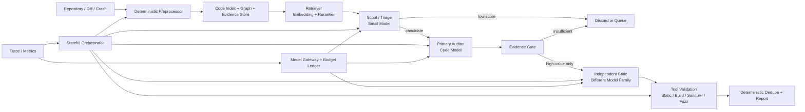

# Multi-Agent Vulnerability Harness

# 1. 제안 목적

- 어떤 역할을 소형 모델에 맡기고, 어떤 후보만 상대적으로 강한 모델로 승격할 것인가?
- 저장소 전체를 반복 전송하지 않고도 cross-file 취약점을 찾을 수 있는가?
- 모델이 바뀌어도 오케스트레이션과 평가 자산을 유지할 수 있는가?
- API 비용 대신 GPU 시간·토큰·전력·검증 시간을 포함한 온프레미스 비용을 어떻게 통제할 것인가?

**초기 목표**는 “많은 에이전트”가 아니라 **적은 수의 역할을 계층적으로 실행하여, 제한된 연산 예산 안에서 검증 가능한 finding을 최대화하는 것**

# 2. 공개 시스템에서 가져올 설계 요소

| 참고 시스템 | 참고할 점 | 차이점 |
| --- | --- | --- |
| **Microsoft MDASH** | Prepare → Scan → Validate/Debate → Dedupe → Prove의 단계 분리, 서로 다른 모델의 교차 검증, evidence 중심 confidence 상승 | 100개 이상의 에이전트와 frontier model 중심 운영 규모 |
| **Theori RoboDuck** | 역할별 모델 매핑, 정적 분석·퍼징·LLM 분석의 병렬 결합, crash triage → PoV → patch 흐름, agent trace와 호출 비용 관찰 | AIxCC 결선의 대규모 API 예산에 맞춘 무제한형 agent fan-out |
| **Buttercup / AIxCC CRS** | Orchestrator, seed generation, fuzzing, program model, patcher를 분리하고 LLM을 기존 분석 도구의 대체재가 아니라 증폭기로 사용 | 초기 단계부터 Kubernetes와 다수의 분산 서비스로 구성하는 운영 복잡도 |
| **Atlantis / OSS-CRS** | 표준 CLI, Docker 기반 재현, 자원·LLM budget 설정, 모듈별 교체와 ensemble 실행 계약 | AIxCC 제출 규격과 patch 생성까지 모두 포함하는 전체 CRS 범위 |

# 3. 초기 하네스 제안 구조



## 3.1 역할은 서비스가 아니라 실행 계약으로 정의

초기에는 에이전트마다 별도 프로세스나 서버를 만들지 않는다. 하나의 agent는 다음 다섯 요소의 조합으로 취급한다.

- `role`: scout, auditor, critic 등 수행 목적
- `model_profile`: 사용할 모델과 fallback
- `tool_policy`: 읽을 수 있는 도구와 명령
- `token_budget`: 입력·출력·재시도 한도
- `output_schema`: 다음 단계가 소비할 구조화 결과

이 정의를 사용하면 agent 수를 늘리지 않고도 동일 역할을 서로 다른 모델로 A/B 평가할 수 있다.

## 3.2 초기 역할은 네 개로 제한

1. **Scout / Triage**
    - attack surface, 변경 지점, sanitizer·정적 분석 신호를 바탕으로 분석 우선순위를 정한다.
    - 많은 후보를 저비용으로 거르는 역할이며 최종 취약점 판정을 하지 않는다.
2. **Primary Auditor**
    - 선택된 함수와 관련 caller·callee·type·guard로 구성된 context capsule을 분석한다.
    - 취약점 가설, source-to-sink 또는 ownership path, 필요한 추가 evidence를 반환한다.
3. **Independent Critic**
    - 상위 후보만 다른 계열 모델로 재검토한다.
    - auditor의 설명을 반복하는 것이 아니라 guard, reachability, aliasing, lifetime, 환경 조건을 중심으로 반박한다.
4. **Evidence Judge**
    - 모델 답변만으로 판정하지 않고 정적 분석 결과, build, sanitizer, fuzzing, 재현 로그를 결합해 상태를 승격한다.
    - 초기에는 대부분 결정론적 규칙으로 구현하고, 애매한 경우에만 모델을 호출한다.

보고서 생성과 dedupe는 가능한 한 템플릿·규칙 기반으로 처리하여 별도 LLM agent를 두지 않는다.

# 4. 초기 모델 구성 제안

| 역할 | 초기 추천 | 제안 이유 | 운영 방식 |
| --- | --- | --- | --- |
| **Code retrieval** | `Qwen3-Embedding-0.6B`  • `Qwen3-Reranker-0.6B` | Apache 2.0, 32K context, code retrieval 지원. 생성 모델에 불필요한 파일을 보내기 전에 저비용으로 후보 문맥을 축소 | 상시 구동, CPU 또는 소량 GPU 사용 |
| **Scout / Triage** | `Qwen3-8B` | Apache 2.0, 128K context. 구조화 분류·요약·우선순위 결정에 사용하고 깊은 취약점 판정은 맡기지 않음 | 짧은 출력, thinking 최소화, 높은 병렬성 |
| **Primary Auditor** | `Qwen3-Coder-30B-A3B-Instruct` | 30.5B total / 3.3B active MoE, Apache 2.0, 256K native context, repository-scale agentic coding에 최적화된 공개 모델 | 선별 후보에만 호출, 양자화와 context 상한을 대상 GPU에서 검증 |
| **Independent Critic** | `Devstral Small 2 24B` | Primary와 다른 모델 계열이며 Apache 2.0, 256K context, codebase 탐색과 tool-use를 위한 공개 coding model | 상위 후보만 batch 검증하며 필요할 때 로드 |

Qwen3-Coder-30B-A3B는 30.5B 전체 파라미터 중 3.3B를 활성화하고 256K context를 제공한다. Qwen3 Embedding/Reranker 0.6B는 코드 검색을 포함한 retrieval·ranking용 공개 모델이다.Devstral Small 2는 24B 공개 coding model로, 동일 모델의 self-consistency 대신 **모델 계열이 다른 critic**을 구성하는 후보로 사용한다.

## 4.1 현재 가용 장비: AI TOP ATOM (NVIDIA GB10)

현재 확보된 온프레미스 장비는 GIGABYTE AI TOP ATOM(NVIDIA GB10 Grace Blackwell Superchip) 1대이며, 스펙은 다음과 같다.

| 항목 | 값 |
| --- | --- |
| 메모리 | 128GB 통합 LPDDR5X (CPU·GPU 공유) *(공식 할당 80 GiB — 34→64(2026-08-25 PL 공식)→80으로 2026-08-31 확장, cgroup `memory.max`=85,899,345,920=80 GiB 실측 확인. `memory.high`는 **이번 확장과 별개로 2026-08-25에 58→`max`로 이미 풀려** 소프트 스로틀이 없다(상한에서 바로 OOM). [model-serving.md](model-serving.md) §1 참조)* |
| 메모리 대역폭 | 273 GB/s |
| 연산 | 1 PFLOP (sparse FP4), 48 SM / 6,144 CUDA 코어 |
| CPU / 아키텍처 | 20코어 Arm (Cortex-X925 ×10 + A725 ×10) / Blackwell (sm_121, CUDA 13.0) |
| 확장 | ConnectX-7 — 2대 연결 시 FP4로 최대 405B 파라미터급 모델 대응 |

이 장비의 특징은 **용량은 넉넉하지만 대역폭이 좁다**는 것이다. 소형(7B급) 모델은 FP4 양자화 시 개당 약 3.5GB로 수십 개를 동시에 적재할 수 있고, 단일 스트림 기준 약 20 tok/s, 32개 요청을 동시에 배칭하면 합산 약 368 tok/s까지 나온다. 반면 같은 정밀도라도 총 파라미터가 큰 모델일수록 토큰마다 읽어야 하는 바이트 수가 늘어나 개별 응답은 대역폭에 의해 느려진다. 즉 **한 명이 대형 모델의 긴 응답을 기다리는 용도보다, 여러 요청을 동시에 처리하는 멀티 에이전트 구성에 유리한 장비이다.**

- **Scout(Qwen3-8B)**: FP4 기준 약 4GB. 다수 동시 요청을 얹기에 부담이 없다.
- **Primary Auditor(Qwen3-Coder-30B-A3B)**: 총 30.5B 중 추론 시 실제로 읽는 파라미터는 3.3B(MoE 활성 파라미터)뿐이라, 좁은 대역폭(273GB/s) 환경에서도 총 파라미터 크기 대비 유리한 구조다. 적재는 NVFP4 기준 약 15GB 수준.
- **Independent Critic(Devstral Small 2 24B)**: dense 모델이라 토큰마다 24B 전체를 읽어야 해서, 같은 크기의 MoE 모델보다 이 장비에서는 상대적으로 느리다. 대역폭이 병목인 만큼 NVFP4를 우선 검토하되, critic 특유의 반박 정확도가 중요하므로 정밀도를 낮췄을 때 품질 저하가 있는지는 반드시 검증한다.
- **Embedding/Reranker(0.6B ×2)**: 상시 상주해도 예산에 거의 영향이 없다.

## 4.2 하드웨어별 실행 프로필

- **AI TOP ATOM 단일 노드 (현재 가용 구성)**
    - Embedding/Reranker, Scout, Primary Auditor, Independent Critic 네 역할을 모두 상시 상주시킨다.
    - Auditor·Critic은 NVFP4 양자화를 기본값으로 검토하고, context 길이가 늘어날수록 KV cache가 대역폭을 더 잠식하므로 8K·16K·32K 기준으로 실측한다.
    - 동시 요청은 소형 모델(Scout, Embedding/Reranker) 위주로 배칭을 크게 가져가고, Auditor·Critic은 후보가 좁혀진 다음에만 호출해 대역폭 병목 구간을 최소화한다.
- **2대 연결 (ConnectX-7) — 향후 확장**
    - AI TOP ATOM을 한 대 더 확보하면 FP4 기준 최대 405B급 모델까지 다룰 수 있어, Primary Auditor를 더 큰 코드 모델로 교체하거나 Critic을 완전히 별도 노드로 분리하는 경로가 열린다.
    - 다만 이는 역할별 benchmark에서 현재 단일 노드 구성의 실제 병목이 확인된 뒤에 검토한다.
- **Scale profile**
    - 동일 agent를 무작정 늘리지 않고, repository shard와 candidate queue만 병렬화한다.
    - 모델 추가는 역할별 benchmark에서 실제 이득이 확인될 때만 허용한다.

실제 메모리 점유는 양자화 방식, KV cache, context 길이, 동시 요청 수에 크게 좌우되므로 모델 선택 전에 AI TOP ATOM에서 8K·16K·32K context 기준으로 직접 측정한다.

# 5. Cost-Effective 및 토큰 효율 전략

## 5.1 Tool-first, Model-second

LLM이 저장소를 처음부터 탐색하게 하지 않는다. 다음 신호를 먼저 수집해 모델 호출 범위를 줄인다.

- diff, changed function, call graph, type relation
- Semgrep·clang 계열 정적 분석 결과
- sanitizer stack trace와 crash location
- fuzz coverage와 미도달 frontier
- 과거 finding·patch와 유사한 코드 패턴

Buttercup이 fuzzing, seed generation, program model과 LLM patcher를 분리한 것처럼, 초기 하네스도 기존 도구가 잘하는 탐색은 도구에 맡긴다.

## 5.2 Full repository prompt 금지

모델에는 저장소 전체가 아니라 **Context Capsule**만 전달한다.

- target function
- 직접 caller·callee 중 관련도 상위 항목
- 사용되는 struct·class·macro·ownership helper
- 입력 경계와 sink
- 관련 diff·trace·정적 분석 신호
- 이미 확인된 사실과 아직 필요한 evidence

Capsule은 파일 hash와 symbol ID로 캐시하고, 동일 코드에 대한 summary를 반복 생성하지 않는다.

## 5.3 Retrieval을 두 단계로 구성

1. symbol·call graph·keyword 기반으로 넓게 수집
2. 0.6B embedding과 reranker로 상위 context만 선택

생성 모델의 긴 context를 “사용 가능하므로 채우는 것”이 아니라, retrieval 실패 시에만 확장한다.

## 5.4 토큰을 대화 기록으로 소비하지 않기

agent 간에는 전체 conversation을 전달하지 않고 `Candidate`, `Evidence`, `Decision`, `MissingEvidence` 구조만 넘긴다. 각 agent는 필요한 source excerpt를 다시 retrieval하며, 다른 agent의 장문 추론을 그대로 prompt에 포함하지 않는다.

## 5.5 Prefix cache와 batch 활용

모든 역할에서 공통 system prompt, weakness checklist, output schema를 prefix로 고정한다. vLLM의 OpenAI-compatible server와 automatic prefix caching을 이용하면 동일 저장소·역할에 대한 반복 요청의 prefill 비용을 줄일 수 있다.

## 5.6 비용 다중 지표로 관리

- input/output/cached token
- GPU-second와 peak VRAM
- wall-clock latency
- cache hit ratio
- 후보별 승격 단계
- validated finding당 GPU-hour
- proven finding당 GPU-hour
- 백만 input token당 유효 finding
- false positive 1건당 사람의 triage 시간

# 6. 유지보수와 지속 가능성을 위한 하네스 제안

## 6.1 Model Registry

역할과 모델을 코드에서 분리한다.

```yaml
profiles:
  local_balanced:
    scout: qwen3-8b
    auditor: qwen3-coder-30b-a3b
    critic: devstral-small-2
    embedding: qwen3-embedding-0.6b
    reranker: qwen3-reranker-0.6b
```

각 모델 항목에는 endpoint, context limit, quantization, license, checksum, prompt template version, fallback과 benchmark 결과를 기록한다.

## 6.2 교체 가능한 네 개의 인터페이스

- `ModelClient`: OpenAI-compatible request와 structured output
- `Retriever`: symbol·graph·embedding 검색
- `ToolRunner`: 정적 분석, build, sanitizer, fuzz 실행
- `StateStore`: run, candidate, evidence, metric 저장

하네스의 domain logic은 이 인터페이스에만 의존한다. vLLM은 온프레미스 inference server로, LiteLLM은 역할별 routing·fallback·budget gateway로 사용할 수 있다. vLLM은 OpenAI-compatible API를 제공하고, LiteLLM은 일관된 API, retry/fallback, spend와 budget 관리를 제공한다.

다만 AI TOP ATOM은 Blackwell sm_121 아키텍처로, vLLM이 DGX Spark(GB10) 전용 실행 레시피를 공식 지원하기 시작한 것은 2026년 6월부터이고 NVFP4 KV cache·speculative decoding 같은 최적화는 아직 커뮤니티 fork 수준에 머무는 경우가 있어, 배포 전 이 장비에서 vLLM 버전과 커널 호환성을 직접 검증해야 한다.

## 6.3 오케스트레이터 종속성 최소화

초기 runtime은 checkpoint, resume, human gate가 필요한 graph workflow에 적합한 LangGraph v1을 후보로 한다. 다만 각 node는 순수 Python 함수와 Pydantic schema로 작성하여, 향후 Temporal·Prefect·자체 scheduler로 옮길 수 있게 한다.

## 6.4 실행 재현성

- repository commit과 source hash
- model·tokenizer·quantization checksum
- prompt·agent spec version
- tool/container image digest
- resolved budget와 threshold
- random seed와 sampling 설정

## 6.5 관찰 가능성은 경량으로 시작

초기에는 `JSONL + OpenTelemetry` trace만 필수로 하고, UI가 필요해질 때 self-hosted Langfuse를 추가한다. Langfuse는 agent trace와 token/cost tracking을 자체 호스팅할 수 있다.

## 6.6 처음부터 분산 시스템으로 만들지 않기

- 단일 Python service
- SQLite 또는 DuckDB state
- local artifact directory
- Docker sandbox
- bounded in-process queue

Redis, Kubernetes, vector database, 다중 worker는 단일 노드 benchmark에서 병목이 확인된 뒤 추가한다.

# 참고 자료

- [Microsoft Codename MDASH FAQ](https://learn.microsoft.com/en-us/security-exposure-management/codename-mdash-faq)
- [Microsoft MDASH 발표](https://www.microsoft.com/en-us/security/blog/2026/05/12/defense-at-ai-speed-microsofts-new-multi-model-agentic-security-system-tops-leading-industry-benchmark/)
- [Theori RoboDuck 공개 저장소](https://github.com/theori-io/aixcc-afc-archive)
- [RoboDuck CRS Architecture](https://github.com/theori-io/aixcc-afc-archive/blob/main/docs/crs-architecture.md)
- [Trail of Bits Buttercup](https://github.com/trailofbits/buttercup)
- [Team Atlanta Atlantis](https://github.com/Team-Atlanta/aixcc-afc-atlantis)
- [OpenSSF OSS-CRS 제안](https://github.com/ossf/tac/blob/main/process/project-lifecycle-documents/oss-crs_sandbox_stage.md)
- [Qwen3-Coder-30B-A3B](https://huggingface.co/Qwen/Qwen3-Coder-30B-A3B-Instruct)
- [Qwen3 Embedding and Reranker](https://qwenlm.github.io/blog/qwen3-embedding/)
- [Mistral Devstral 2](https://mistral.ai/news/devstral-2-vibe-cli/)
- [LangGraph Persistence](https://docs.langchain.com/oss/python/langgraph/persistence)
- [LiteLLM](https://docs.litellm.ai/)
- [vLLM OpenAI-Compatible Server](https://docs.vllm.ai/en/latest/serving/online_serving/openai_compatible_server/)
- [Langfuse Token and Cost Tracking](https://langfuse.com/docs/observability/features/token-and-cost-tracking)