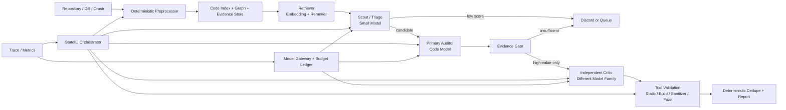

# 시스템 아키텍처

## 1. 설계 원칙

1. **Tool-first, Model-second**: 결정론적 도구가 잘하는 탐색(diff, 정적분석, sanitizer, fuzz)은 도구가 한다. LLM은 도구가 남긴 신호를 해석하는 데만 쓴다.
2. **역할은 서비스가 아니라 실행 계약**: 에이전트마다 프로세스를 띄우지 않는다. 하나의 프로세스 안에서 `role + model_profile + tool_policy + token_budget + output_schema` 조합으로 실행된다. → [agent-contracts.md](agent-contracts.md)
3. **비싼 단계일수록 뒤에**: 후보는 단계마다 줄어들고, 모델은 뒤로 갈수록 커진다. 각 단계는 통과율(제거율)을 기록한다.
4. **에이전트 간에는 대화가 아니라 구조체만 전달**: 다른 에이전트의 장문 추론을 프롬프트에 넣지 않는다.
5. **처음부터 분산 시스템을 만들지 않는다**: 단일 Python 서비스 + SQLite/DuckDB + 로컬 artifact 디렉터리 + Docker sandbox. (~~bounded in-process queue~~ — D25로 2026-08-31 제거, 재투입 경로가 생기면 다시 연다)

## 2. 파이프라인



> **위 그림에서 Evidence Gate가 한 칸으로 보이지만 판정은 세 번 돈다.** 게이트는 단계가 아니라
> **순수 함수(술어)**이고 6·7·8단계에서 각각 호출된다(`stages.GATE_STAGES`). 그림의 칸은 그중
> **전이가 갈라지는 유일한 자리**인 6단계다 — 7단계 재판정은 Critic 노드 안에서 돌아 그 노드의
> 전이 신호에 실리고, 8단계 재판정은 등급을 **집계만** 한다. 등급이 언제 성립하고 승격이 어디서
> 정해지는지는 §4의 두 표에 나눠 적었다.

## 3. 단계별 책임과 통과 조건

| # | 단계 | 입력 | 처리 | 출력 | 다음 단계 통과 조건 |
| --- | --- | --- | --- | --- | --- |
| 0 | Preprocessor | repo / firmware image / crash bundle | 펌웨어 추출(binwalk), 파일 타입 분류(file), 바이너리·소스·설정 식별, artifact hash 부여 | `Artifact[]` | 파일 타입 분류 성공 |
| 1 | Index & Graph | `Artifact[]` | 소스: tree-sitter로 함수·symbol·AST 분해 / 바이너리·펌웨어: strings, readelf, objdump, Ghidra Headless. 공통으로 symbol table, xref, function boundary, call graph 추출 | Code Index, Graph | 대상 함수 심볼 해석 성공 |
| 2 | Signal Collection | Artifact, Index | Semgrep · clang-tidy · grep/custom rule 정적분석, sanitizer log·stack trace 파싱, AFL++/libFuzzer coverage, diff 분석 | `Evidence[]` | 실패해도 진행(신호 부재로 기록) |
| 3 | Retrieval | 후보 seed | symbol·graph·keyword 광역 수집 → embedding + reranker 재선별 | `ContextCapsule` | capsule 토큰 상한 이내 |
| 4 | Scout / Triage | `ContextCapsule`(경량) | 후보 우선순위 분류, 위험 카테고리 부여 | `Candidate[]` (score, CWE 추정) | `score >= scout_threshold` |
| 5 | Primary Auditor | `ContextCapsule`(확장) + `Candidate` | source-to-sink, memory lifetime, boundary·guard 분석, RCA 초안 | `Finding`(draft) + `MissingEvidence[]` | Evidence Gate 판정 |
| 6 | Evidence Gate | `Finding` + `Evidence[]` | 결정론적 규칙으로 근거 충족 여부 판정. 애매한 경우에만 모델 호출 | 상태 승격/보류/폐기 | 근거 등급 §4 참조 |
| 7 | Independent Critic | 상위 `Finding`만 | 다른 계열 모델로 guard·reachability·aliasing·lifetime·환경 조건 반박 | `Decision`(rebut/uphold) + 근거 | 반박이 기각될 때 |
| 8 | Tool Validation | `Finding` + 재현 명세 | build, sanitizer, fuzz, PoC 실행 (Docker sandbox) | 실행 로그 `Evidence` | 재현 성공 시 `proven` |
| 9 | Dedupe & Report | `Finding[]` | 규칙 기반 중복 제거, 템플릿 리포트 생성 | 리포트 | — |

> **이 표는 지금 구조다. 앞으로 각 단계에 무엇을 넣는가는 [build-plan.md](build-plan.md)에 있다** — 단계 번호 0~9를 그대로 쓰므로 좌표계가 같다. 거기는 설계이고 여기는 책임 정의라 섞지 않는다.
>
> **분석 대상 범위 — 1차는 C/C++ 소스 저장소다** ([ADR 0010](decisions/0010-harness-structure-and-model-roster.md) §5, 2026-09-09 승인). 킥오프 발표자료 04-1이 대상을 "펌웨어의 취약점 분석"으로 명시했고 이 문단도 그에 따라 ~~"바이너리·펌웨어도 1급 입력이므로 0·1단계는 두 경로를 **둘 다** 갖춰야 한다"~~고 적었다. 중간발표 슬라이드 8의 "C/C++ 오픈소스 Zero-Day"가 팀의 현재 목표이고, **확정된 슬라이서가 소스 기반**(Joern CPG — [CONTEXT.md](../CONTEXT.md) §2)이라 펌웨어를 1급 입력으로 두면 1단계가 성립하지 않는다. **바이너리·펌웨어는 2차다** — 위 표 0·1단계의 바이너리 경로는 책임 정의로 남되 구현 순서에서 뒤다. 등재는 [open-questions.md](open-questions.md) D9(닫힘).
>
> **단계 순서 주의**: 위 표는 `Evidence Gate(6) → Critic(7)` 순서다. 킥오프 04-6 표는 `Critic(4차) → Evidence Gate(5차)`로 반대이나, 같은 자료의 05-2 구조도와 하네스 제안서 §3은 위 순서를 따른다. 다수 근거를 채택했고 확정은 [open-questions.md](open-questions.md) D8.

**Queue 규칙**: 4·6단계에서 탈락한 후보는 즉시 버리지 않고 `queued` 상태로 남긴다. 새 Evidence(신규 crash, 신규 정적분석 룰)가 들어오면 해당 후보만 재평가한다.

> **⚠ 절반만 구현이다 (2026-08-31, D25).** `queued`로 남기는 쪽은 동작한다(`policy.py`의 `Route.QUEUE`).
> **새 Evidence로 재평가하는 쪽은 배선이 없다** — `DecisionPoint.REQUEUE`를 내는 코드가 저장소에 없고,
> 재평가 횟수를 보관하던 `queue.py`도 D25로 사라졌다(D10). 이 문단은 설계이지 현황이 아니다.

## 4. Finding 상태 머신

```
candidate ──scout pass──> triaged ──auditor──> hypothesized
                                                  │
                                     evidence gate│
                        ┌──insufficient───────────┤
                        ▼                         ▼ sufficient
                     queued  <──rebutted──  critic review
                        │                         │ upheld + 재현 명세
                        │                         ▼
                        │                     validated
                        │                         │ tool validation 재현 성공
                        │                         ▼
                        │                      proven ──> reported
                        │                                 (2인 검증 후, disclosure-policy.md)
                        │
                        └──new evidence──> candidate | hypothesized   (재평가)
```

**`queued`에서 돌아가는 곳은 `validated`가 아니다.** 새 Evidence가 들어오면 Candidate는
`candidate`로, Finding은 `hypothesized`로 돌아가 게이트를 처음부터 다시 통과해야 한다 —
재평가가 판정 단계를 건너뛰면 근거 등급이 검증되지 않은 채로 승격된다. 재평가 횟수 상한은
config(`requeue_max`)에서 오고, 초과해도 폐기하지 않고 `queued`를 유지한다.

> **⚠ 위 그림의 `new evidence` 재진입은 §3의 ⚠ 대로 배선이 없다** (2026-08-31, D25).
> `queued`로 남기는 쪽은 동작하지만 새 Evidence로 되돌리는 쪽은 `DecisionPoint.REQUEUE`를
> 내는 코드가 없고, 재평가 횟수를 세던 카운터도 사라졌다(D10). 설계이지 현황이 아니다.

> 전이 표 전체(트리거·단계·사유 코드)는 `src/orchestrator/state_machine.py`의 모듈
> docstring에 있다. 이 그림은 그 표의 요약이며, 둘이 어긋나면 표가 기준이다.

근거 등급(Evidence Gate 판정 기준):

**아래 표는 판정 순서가 아니라 근거 강도의 정의다.** 게이트는 파이프라인의 한 칸이 아니라
6·7·8단계에서 각각 도는 순수 함수이고(`stages.GATE_STAGES`, `RunContext.evaluate_gate()`가
그 상수로 호출 단계를 강제한다), E3·E4는 *나중에 매기는 등급*이 아니라 **그 재료가 나오기
전에는 성립할 수 없는 등급**이다. 재료가 없으면 `gate.py`의 단조 하강 판정식이 자동으로 아래
등급을 준다 — **6단계에서 E3 술어가 거짓인 것은 결함이 아니라 정의다.**

| 등급 | 성립 조건 | 이 등급이 처음 성립 가능한 단계 |
| --- | --- | --- |
| E0 | 모델 주장만 존재 | 6 |
| E1 | 정적분석 신호 또는 코드 경로가 후보와 일치 | 6 |
| E2 | source→sink 경로가 call graph로 확인되고 guard 부재가 코드로 확인 | 6 |
| E3 | Critic이 반박 실패 + 재현 명세 존재 | 7 — Critic 출력이 있어야 성립한다 |
| E4 | sanitizer/crash/PoC 재현 로그 존재 | 8 — 도구 실행 로그가 있어야 성립한다 |

**승격은 게이트가 하지 않는다 — 두 축을 한 표에 넣지 않는 이유다.** `gate.py`는 등급만 내고
전이는 노드와 정책이 한다(모듈 docstring: *"등급을 전이로 매핑하는 것은 노드 몫이고, trace
기록도 호출자가 한다"*). 한 칸에 뭉치면 "게이트가 Critic 결과를 받아 승격시킨다"로 읽혀
**6 → 7 순서가 거꾸로로 보인다.**

| 등급 | 그 등급에서 가는 곳 | 전이를 정하는 자리 |
| --- | --- | --- |
| E0 | `queued` (폐기 아님) | 6단계 · `DecisionPoint.GATE_GRADE` |
| E1 | `hypothesized` 유지 | 6단계 · `DecisionPoint.GATE_GRADE` |
| E2 | Critic으로 (`high-value only`) | 6단계 · `DecisionPoint.GATE_GRADE` |
| E3 | `validated` | 7단계 · `DecisionPoint.CRITIC_VERDICT` (신호에 `grade`가 실린다) |
| E4 | `proven` | 8단계 — **⚠ 등급을 읽지 않는다. 아래 참조** |

> **⚠ 위 표의 E4 행은 설계이고 현황이 아니다.** 8단계의 게이트 호출은 `nodes/validate.py`가
> **반환값을 버린다** — 목적이 판정이 아니라 집계다. 승격 정책(`policy._repro_result()`)이 읽는
> 것은 도구의 `ok`·`tool_allowed`뿐이라, 게이트가 E3인 Finding도 `ok=True`면 `proven`이 된다.
> **8단계에서 등급은 집계 전용이고 상태 축과 등급 축이 어긋난 채로 남아 있다.**
> → [open-questions.md](open-questions.md) D18

구체적 임계값(`scout_threshold`, 단계별 승격 비율)은 실측 후 확정한다. → [open-questions.md](open-questions.md)

## 5. 횡단 구성 요소

| 구성 요소 | 책임 | 비고 |
| --- | --- | --- |
| Stateful Orchestrator | 단계 실행 순서, checkpoint/resume, human gate | LangGraph v1 후보. 각 node는 순수 함수 + Pydantic schema |
| Model Gateway | 역할→모델 라우팅, fallback, 구조화 출력 강제, prefix cache 활용 | vLLM(OpenAI-compatible) + LiteLLM |
| Budget Ledger | 실행 단위 토큰·GPU-second 한도 집행, 초과 시 단계 차단 | 예산 소진 시 부분 결과로 리포트 |
| Evidence Store | 세션에서 관찰된 사실(로그, 분석 결과) 저장 | KB(재사용 지식)와 분리 → [knowledge-base.md](knowledge-base.md) |
| Trace / Metrics | JSONL + OpenTelemetry trace, 단계별 통과율·비용. 모델 호출(`model_call`)과 검색 호출(`retrieval_call`)을 분리 기록한다 — 후자는 출력 스키마가 없어 같은 분모에 넣으면 지표가 섞인다 | → [evaluation.md](evaluation.md) |
| Tool Sandbox | build/sanitizer/fuzz/PoC 실행 격리 | Docker, 네트워크 차단 기본값 |

## 6. 명시적 비범위 (MVP)

- 패치 자동 생성 (AIxCC CRS의 patcher 범위는 제외)
- Kubernetes·분산 워커·외부 vector DB
- LLM 기반 리포트 생성 에이전트 (템플릿 + 규칙으로 처리)
- LLM 기반 dedupe 에이전트
- 다중 노드(ConnectX-7 2대) 구성 — 단일 노드 병목 확인 후 재검토
