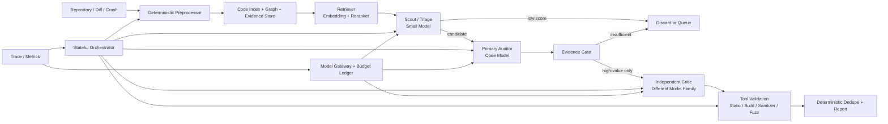

# 시스템 아키텍처

## 1. 설계 원칙

1. **Tool-first, Model-second**: 결정론적 도구가 잘하는 탐색(diff, 정적분석, sanitizer, fuzz)은 도구가 한다. LLM은 도구가 남긴 신호를 해석하는 데만 쓴다.
2. **역할은 서비스가 아니라 실행 계약**: 에이전트마다 프로세스를 띄우지 않는다. 하나의 프로세스 안에서 `role + model_profile + tool_policy + token_budget + output_schema` 조합으로 실행된다. → [agent-contracts.md](agent-contracts.md)
3. **비싼 단계일수록 뒤에**: 후보는 단계마다 줄어들고, 모델은 뒤로 갈수록 커진다. 각 단계는 통과율(제거율)을 기록한다.
4. **에이전트 간에는 대화가 아니라 구조체만 전달**: 다른 에이전트의 장문 추론을 프롬프트에 넣지 않는다.
5. **처음부터 분산 시스템을 만들지 않는다**: 단일 Python 서비스 + SQLite/DuckDB + 로컬 artifact 디렉터리 + Docker sandbox. (~~bounded in-process queue~~ — D25로 2026-08-31 제거, 재투입 경로가 생기면 다시 연다)

## 2. 파이프라인



> **위 그림에서 Evidence Gate가 한 칸으로 보이지만 판정은 세 번 돈다.** 게이트는 단계가 아니라
> **순수 함수(술어)**이고 6·7·8단계에서 각각 호출된다(`stages.GATE_STAGES`). 그림의 칸은 그중
> **게이트 등급만으로 전이가 갈라지는 자리**인 6단계다(`policy._gate_grade`의 `basis`가 `grade`
> 하나다) — 7단계 재판정은 Critic 노드 안에서 돌아 그 노드의 전이 신호에 실리고, 8단계 재판정도
> 2026-09-20부터 같은 모양으로 그 단계의 전이 신호에 실린다(F-10 / F-10b — 후자는 도구가 떴지만 종료
> 코드가 0인 재현이 간다, 2026-10-02부터 · 이슈 #232).
> 등급이 언제 성립하고
> 승격이 어디서 정해지는지는 §4의 두 표에 나눠 적었다.

## 3. 단계별 책임과 통과 조건

| # | 단계 | 입력 | 처리 | 출력 | 다음 단계 통과 조건 |
| --- | --- | --- | --- | --- | --- |
| 0 | Preprocessor | repo / firmware image / crash bundle | 펌웨어 추출(binwalk), 파일 타입 분류(file), 바이너리·소스·설정 식별, artifact hash 부여 | `Artifact[]` | 파일 타입 분류 성공 |
| 1 | Index & Graph | `Artifact[]` | 소스: tree-sitter로 함수·symbol·AST 분해 · **Joern 슬라이서**(무모델 Case A·B — [PROJECT-CONTEXT.md](../PROJECT-CONTEXT.md) §2. 지금은 하네스 밖 오프라인 `slicer.py`) / 바이너리·펌웨어: strings, readelf, objdump, Ghidra Headless. 공통으로 symbol table, xref, function boundary, call graph 추출 | Code Index, Graph · `slices.json`(아래 ⚠ ADR 0012) | 대상 함수 심볼 해석 성공 |
| 2 | Signal Collection | Artifact, Index | Semgrep · clang-tidy · grep/custom rule 정적분석, **build 프로브**(빌드되는가 — Auditor가 `repro_spec`을 쓸 근거, 아래 build 주), sanitizer log·stack trace 파싱, AFL++/libFuzzer coverage, diff 분석 | `Evidence[]` | 실패해도 진행(신호 부재로 기록) |
| 3 | Retrieval | 후보 seed | symbol·graph·keyword 광역 수집 → embedding + reranker 재선별(쓰임은 아래 ⚠ ADR 0012 — 열림) | `ContextCapsule` | capsule 토큰 상한 이내 |
| 4 | Scout / Triage | `ContextCapsule`(경량) + 대상 코드(아래 ⚠ ADR 0012 — 슬라이스로 바뀐다) | 후보 우선순위 분류, 위험 카테고리 부여 | `Candidate[]` (score, CWE 추정) | `score >= scout_threshold` |
| 5 | Primary Auditor | `ContextCapsule`(확장) + `Candidate` + 대상 원본 소스(슬라이스 타깃이면 걸친 함수들 — 아래 ⚠ ADR 0012 결정 1-b) | source-to-sink, memory lifetime, boundary·guard 분석, RCA 초안 | `Finding`(draft) + `MissingEvidence[]` | Evidence Gate 판정 |
| 6 | Evidence Gate | `Finding` + `Evidence[]` | 결정론적 규칙으로 근거 충족 여부 판정. 애매한 경우에만 모델 호출 | 상태 승격/보류/폐기 | 근거 등급 §4 참조 |
| 7 | Independent Critic | 상위 `Finding`만 | 다른 계열 모델로 guard·reachability·aliasing·lifetime·환경 조건 반박 | `Decision`(rebut/uphold) + 근거 | 반박이 기각될 때 |
| 8 | Tool Validation | `Finding` + 재현 명세 | build, sanitizer, fuzz, PoC 실행 (Docker sandbox) | 실행 로그 `Evidence` | 재현 성공 **그리고** Gate E4일 때 `proven` (E4 미만이면 `validated` 유지 — 도구가 떴지만 종료 코드가 0인 재현이 그 갈래다, §4) |
| 9 | Dedupe & Report | `Finding[]` | 규칙 기반 중복 제거, 템플릿 리포트 생성 | 리포트 | — |

> **이 표는 지금 구조다. 앞으로 각 단계에 무엇을 넣는가는 [build-plan.md](build-plan.md)에 있다** — 단계 번호 0~9를 그대로 쓰므로 좌표계가 같다. 거기는 설계이고 여기는 책임 정의라 섞지 않는다.
>
> **분석 대상 범위 — 1차는 C/C++ 소스 저장소다** ([ADR 0010](decisions/0010-harness-structure-and-model-roster.md) §5, 2026-09-09 승인). 킥오프 발표자료 04-1이 대상을 "펌웨어의 취약점 분석"으로 명시했고 이 문단도 그에 따라 ~~"바이너리·펌웨어도 1급 입력이므로 0·1단계는 두 경로를 **둘 다** 갖춰야 한다"~~고 적었다. 중간발표 슬라이드 8의 "C/C++ 오픈소스 Zero-Day"가 팀의 현재 목표이고, **확정된 슬라이서가 소스 기반**(Joern CPG — [PROJECT-CONTEXT.md](../PROJECT-CONTEXT.md) §2)이라 펌웨어를 1급 입력으로 두면 1단계가 성립하지 않는다. **바이너리·펌웨어는 2차다** — 위 표 0·1단계의 바이너리 경로는 책임 정의로 남되 구현 순서에서 뒤다. 등재는 [open-questions.md](open-questions.md) D9(닫힘).
>
> **단계 순서 주의**: 위 표는 `Evidence Gate(6) → Critic(7)` 순서다. 킥오프 04-6 표는 `Critic(4차) → Evidence Gate(5차)`로 반대이나, 같은 자료의 05-2 구조도와 하네스 제안서 §3은 위 순서를 따른다. 다수 근거를 채택했고 확정은 [open-questions.md](open-questions.md) D8.

> ⚠ **2026-09-24 — [ADR 0012](decisions/0012-harness-canon-v2.md)가 위 표의
> 1·3·4·5단계 입력을 다시 정한다. 승인됐다(2026-09-25) — 코드는 아직이다 — 위 칸은 지금 구조이고 아래가 그 결정이다.**
> (⏵ 2026-09-25 — 결정 1의 입력 쪽은 `run --slices`로 돈 run에 들어왔다(Phase 3a·3b·3c) — 아래 1·4·5단계 불릿의 ⏵가
> 무엇이 들어왔는지 적는다. `--slices` 없는 run은 위 칸 그대로다.)
>
> - **1단계 — 슬라이스가 후보가 된다**(결정 1, Phase 3). Joern 슬라이스 1개 = 후보 1개. 지금 슬라이서는
>   하네스 밖 오프라인 스크립트이고 러너의 후보는 tree-sitter `symbols_for()`의 심볼이다
>   (`runner._plan_targets`) — `src/`·`config/`에 `slices.json`을 읽는 코드가 0건이다. tree-sitter 인덱스는
>   `GRAPH` Evidence·`callers`/`callees`에 더해 need_evidence resolver의 심볼 표(index-v2, Phase 4)가 된다.
>   (⏵ 2026-09-25 — `run --slices`면 슬라이스 1개가 타깃 1개다(`runner._plan_slice_targets` — Phase 3a PR #283 ·
>   3b PR #284 · 3c). 후보는 그 타깃을 본 Scout 자리마다 하나라 풀이면 셋이다. 슬라이서는 여전히 run 밖에서 돌고
>   하네스는 `slices.json`을 파일로 받는다. `--slices` 없는 run의 타깃은 앞 문장 그대로 tree-sitter 심볼이다.)
> - **3단계 — 쓰임이 열려 있다**(결정 3, 2026-09-26 대면 논의). ADR 0012가 그 논의 전에 정해 두는
>   것은 둘이다 — need_evidence는 결정론적 심볼 resolver가 풀고(결정 2), canonical 프로필은 합의 전까지
>   `retriever: hybrid`를 쓰지 않는다. ~~canonical 프로필은 아직 없다(Phase 6).~~ (⏵ 2026-09-24 — 생겼다:
>   `harness_pool`(`retriever: fake`)이다 — `config/profiles.yaml`.) 임베딩·리랭커를
>   어디에 쓸지는 그 논의가 정한다. 지금 코드의 3단계는 위 칸 그대로 캡슐을 만들고, 임베딩·리랭커는
>   `retriever: hybrid` 프로필의 EXPANDED·FOCUSED `related` 섹션에서만 돈다.
> - **4단계 — Scout 입력이 슬라이스가 되고 need_evidence 루프가 붙는다**(결정 1·2). 슬라이스는 v3
>   프롬프트가 요구하는 모양(줄번호 gutter · `/* ===== path ===== */` 배너 · `FACTS.slice_criterion` —
>   `prompts/scout_*/v3/prefix.md`)으로 가고, `triage_need_evidence`를 낸 좌석에는 하네스가 심볼
>   인덱스에서 찾은 RETRIEVED를 같은 세션 후속 턴으로 준다(최대 3홉 — 다른 좌석이 review를 냈으면 돌지 않는다,
>   결정 2 「좌석 집계」). 지금은 LIGHT 캡슐 +
>   `read_symbol_source()`의 심볼 본문이고, v3 `ScoutResponse`의 `analysis_summary`는 버려지며
>   (`nodes/scout.py`) `triage_need_evidence`(0.30)도 `triage_reject`(0.10)처럼 `scout_threshold` 미만으로
>   `queued`된다 — 루프 0건. 풀 프로필의 v3 프롬프트가 이미 슬라이스를 전제해 지금 입력과 어긋난다 →
>   [D82](open-questions/D/D82.md). Phase 3·5. (⏵ 2026-09-25 — 입력 쪽은 `run --slices`로 돈 run에서 그 모양이
>   됐다(Phase 3c): `SOURCE`가 슬라이스 렌더이고 FACTS에 `slice_criterion`이 붙으며 LIGHT 캡슐이 그 렌더를 센다.
>   need_evidence 루프는 그대로 0건이다(Phase 5).)
> (⏵ 2026-09-26 — 루프가 이 변경으로 배선됐다: `runner._step_scout_open`(hop0)·`_step_scout_settle`
> (동료 확인 → `_run_ne_hops`)이 `Stage.SCOUT`을 두 행으로 가르고, `triage_need_evidence`는 더 이상
> `scout_threshold` 미만 취급으로 `below_scout_threshold`에 묻히지 않는다 — `policy._scout_triage`가
> `signals["signal"]`을 점수보다 먼저 보고 승격(review)·보류(reject·need_evidence 소진)를 가른다. 홉마다
> `EventKind.SCOUT_HOP`이 난다. **한계** — 홉당 글자 상한(`_HOP_CHARS_MAX` 15,000자, 남은 토큰 × 3.28)의
> 여유 `_HOP_TOKEN_MARGIN`(512)은 설계값이고 미실측이다. RETRIEVED 코드 블록만의 글자/토큰 비는 안
> 쟀다 — 3.28은 Scout 좌석 전체의 실측 하한이다. 실서빙 run에서 이 루프가 도는 것은 아직 안 쟀다
> (ATOM 스모크 전).)
> - **5단계 — Auditor는 원본 소스를 받는다**(결정 1-b = 넓은 (i), 2026-09-25 팀 합의 —
>   `prompts/auditor/v3/body.md`의 `representation: original source code` — ⏵ 2026-09-29 v4, ⏵ 2026-10-03 v6, ⏵ 2026-10-04 v7, ⏵ 같은 날 **v8**(도구 루프 · body는 v6와 바이트 동일), ⏵ 2026-10-06 지금 배선된 **v9**(v8 + `auditor_guards` 서술 · body 동일)는
>   `body.md`의 「Target under analysis — original source code」 제목으로 같은 선언을 한다). 슬라이스 타깃이면 슬라이스가 걸친
>   함수들의 원본이다 — entry 줄을 감싸는 함수(품는 함수를 모르면 — 인덱스가 없거나 그 줄이 어느 정의에도
>   안 들면(프로토타입·전역·매크로) — entry 앞뒤 고정 창 `_AUDITOR_WINDOW_LINES`)가 먼저이고 나머지는 문자 수 상한(`_AUDITOR_SOURCE_CHARS`)
>   안에서 함수째 붙는다(`runner._auditor_source` — 파일 전체는 상한 없이 실려 막았다). 상한이 뺀 함수와 어느
>   함수에도 안 든 줄은 trace `auditor_source`가 센다. ⏵ 2026-10-01 #349 -> 이 모양을 넓히는 옵션 다섯
>   (`config.AUDITOR_SOURCE_OPTIONS`)은 ~~전부 기본 꺼짐~~. 켜면 Auditor 프롬프트 meta의 `source_options`가 그 키를 들어야
>   run이 선다. ⏵ 2026-10-03 -> 넷을 켰다(`config/budgets.yaml` — 20,000토큰 상한 · 정의 · 피호출 본문 1단 · 호출자 창 10줄 · entry 줄이기만 꺼짐).
>   상한은 토큰이 되고 함수 뒤에 정의 · 피호출 본문 · 호출자 창이 붙는다. 서빙 판은 ⏵ 2026-10-04 **v8**이었고(⏵ 2026-10-06부터 v9 — v8 + `auditor_guards` 서술)
>   그 절을 v7에서 바이트 그대로 물려받았다(도구 루프, #419). 그 전 판 v7(⏵ 2026-10-04 — v6 + 그 서술,
>   v6는 #418이 잰 문장 그대로)이 그 모양을 서술한다. ⏵ 2026-10-04 -> 피호출 본문 1단 너머는 다섯째 옵션
>   `auditor_callee_wrappers`(이슈 #451 · `budgets.yaml`이 켬)다 -> 짧은 래퍼면 그 너머 2단까지, 이름만 바꾸는 매크로면
>   그 대상 정의·함수를 2번까지 더 붙인다(v7·v8이 서술). ⏵ 같은 날 -> 간접 피호출(`auditor_indirect_callees` — 필드
>   경유 호출의 후보 함수 본문, 필드마다 3개 이하일 때)·쓰기 지점 창(`auditor_write_sites` — 파일 변수·필드에 쓰는 지점 앞뒤
>   3줄, 6곳까지 · 호출자 창 뒤)도 켜져 있고 v7·v8이 서술한다(#304 · index-v3 표 — 이미지 재빌드 전에는 안 붙는다).
>   ⏵ 같은 날 -> 여덟째 `auditor_guards`(sink 앞 구문상 가드 목록 — Case B만)는 ~~꺼져 있고~~ ⏵ 2026-10-06 **켜져 있다**(`budgets.yaml`이 `1`)
>   — v9가 서술·선언한다(v7·v8은 선언하지 않아 켜고 그 둘을 고르면 `cli`가 막는다). 켜면 entry 함수 바로 뒤에 붙고 8단계 PoV(`pov._WIDE_INPUT_VERSIONS` 판)가 같은 SOURCE 문자열로 받아
>   PoV 프롬프트에도 든다
> - **슬라이스·RETRIEVED는 Evidence가 아니다**(결정 1). STATIC으로 적으면 E1이 구조적으로 참이 된다
>   ([D78](open-questions/D/D78.md) ③).

> **build는 두 번 돈다 — 2단계 프로브와 8단계 재현 빌드**(2026-09-24, 위 2단계 칸을 코드에 맞췄다 —
> [D12](open-questions/D/D12.md) 선택지 (a)). 2단계가 오늘 돌리는 도구는 `SIGNAL_TOOLS` = semgrep ·
> clang-tidy · build 셋이다(`src/orchestrator/nodes/signals.py` — 러너 `_plan_targets`가 artifact마다
> 부른다). build 신호는 Auditor가 `repro_spec`을 쓸 수 있는지를 가른다 — 빌드되는지 모르는 채 지어낸
> 재현 절차는 8단계가 실행할 수 없다(같은 파일 주석). 8단계는 재현 명세의 `steps`로 다시 빌드한 뒤
> sanitizer·PoC를 돌린다(`nodes/validate.py`의 `BUILD_TOOL`). 위 2단계 칸의 나머지(sanitizer log·stack
> trace 파싱, fuzz coverage, diff 분석)는 책임 정의이고, 오늘 2단계에서 그 일을 하는 도구는 없다.

**Queue 규칙**: 4·6단계에서 탈락한 후보는 즉시 버리지 않고 `queued` 상태로 남긴다. ~~새 Evidence(신규 crash, 신규 정적분석 룰)가 들어오면 해당 후보만 재평가한다.~~ (⏵ 2026-09-25 — ADR 0012 결정 6으로 폐기 — 아래 ⚠)

> **⚠ 절반만 구현이다 (2026-08-31, D25).** `queued`로 남기는 쪽은 동작한다(`policy.py`의 `Route.QUEUE`).
> **새 Evidence로 재평가하는 쪽은 배선이 없다** — `DecisionPoint.REQUEUE`를 내는 코드가 저장소에 없고,
> 재평가 횟수를 보관하던 `queue.py`도 D25로 사라졌다(D10). 이 문단은 설계이지 현황이 아니다.
>
> ⚠ **2026-09-24 — [ADR 0012](decisions/0012-harness-canon-v2.md) 결정 6: 이 재평가 경로를
> 폐기한다.** 대상은 생산자·호출처가 0건인 세 경로와 그 소비부다 — ① 재평가: `DecisionPoint.REQUEUE`와
> `policy._requeue`·전이 C-8·C-9·F-14·`requeue_max` ② 캡슐 확장: `Retriever.expand`·노드
> `retrieval.expand()`와 전이 C-5(`triaged`→`queued`)·`capsule_expansion_max` — 돌아오는 길이 아니라
> `queued`로 **들어가는** 길이다 ③ `previous` 재판정: `scout.run(previous=…)`에서만 서는 전이 C-4와 C-7의
> `candidate` 행. **승인됐다(2026-09-25) — 코드는 아직 그대로다**(코드 삭제는 별도 PR). 탈락 후보를 `queued`로 남기는 쪽(위 첫 문장의 4·6단계
> 탈락 C-3·F-2와, 5단계에서 남기는 C-6·C-7의 `triaged` 행 등)은 이 결정과 무관하다. ⚠ **위 규칙의 뒤 절반은 대체 없이 없어진다** —
> 4단계 need_evidence 루프(결정 2)는 같은 세션 안에서 후보를 만들기 전에 모자란 맥락을 채울 뿐이고,
> 나중에 들어온 새 Evidence(신규 crash·신규 룰)로 `queued` 후보를 다시 보는 길은 없다(run을 넘는
> 재평가는 하지 않는다).

## 4. Finding 상태 머신

```
candidate ──scout pass──> triaged ──auditor──> hypothesized
                                                  │
                                     evidence gate│
                        ┌──insufficient───────────┤
                        ▼                         ▼ sufficient
                     queued  <──rebutted──  critic review
                        │                         │ upheld + 재현 명세
                        │                         ▼
                        │                     validated
                        │                         │ tool validation 재현 성공 + Gate E4
                        │                         ▼
                        │                      proven ──> reported
                        │                                 (2인 검증 후, disclosure-policy.md)
                        │
                        └──new evidence──> candidate | hypothesized   (재평가)
```

**`queued`에서 돌아가는 곳은 `validated`가 아니다.** 새 Evidence가 들어오면 Candidate는
`candidate`로, Finding은 `hypothesized`로 돌아가 게이트를 처음부터 다시 통과해야 한다 —
재평가가 판정 단계를 건너뛰면 근거 등급이 검증되지 않은 채로 승격된다. 재평가 횟수 상한은
config(`requeue_max`)에서 오고, 초과해도 폐기하지 않고 `queued`를 유지한다.

> **⚠ 위 그림의 `new evidence` 재진입은 §3의 ⚠ 대로 배선이 없다** (2026-08-31, D25).
> `queued`로 남기는 쪽은 동작하지만 새 Evidence로 되돌리는 쪽은 `DecisionPoint.REQUEUE`를
> 내는 코드가 없고, 재평가 횟수를 세던 카운터도 사라졌다(D10). 설계이지 현황이 아니다.
> **2026-09-24 — 이 재진입과 위 문단의 `requeue_max`는 폐기가 결정됐다**(2026-09-25 승인 — 코드(`config/budgets.yaml`의 `requeue_max` · `policy._requeue`)는 아직 남아 있고 지우는 것은 별도 PR이다 — §3 Queue 규칙의 ⚠ —
> ADR 0012 결정 6).

> 전이 표 전체(트리거·단계·사유 코드)는 `src/orchestrator/state_machine.py`의 모듈
> docstring에 있다. 이 그림은 그 표의 요약이며, 둘이 어긋나면 표가 기준이다.

근거 등급(Evidence Gate 판정 기준):

**아래 표는 판정 순서가 아니라 근거 강도의 정의다.** 게이트는 파이프라인의 한 칸이 아니라
6·7·8단계에서 각각 도는 순수 함수이고(`stages.GATE_STAGES`, `RunContext.evaluate_gate()`가
그 상수로 호출 단계를 강제한다), E3·E4는 *나중에 매기는 등급*이 아니라 **그 재료가 나오기
전에는 성립할 수 없는 등급**이다. 재료가 없으면 `gate.py`의 단조 하강 판정식이 자동으로 아래
등급을 준다 — **6단계에서 E3 술어가 거짓인 것은 결함이 아니라 정의다.**

| 등급 | 성립 조건 | 이 등급이 처음 성립 가능한 단계 |
| --- | --- | --- |
| E0 | 모델 주장만 존재 | 6 |
| E1 | 정적분석 신호 또는 코드 경로가 후보와 일치 | 6 |
| E2 | source→sink 경로가 call graph로 확인되고 guard 부재가 코드로 확인 | 6 |
| E3 | **E2의 조건 전부** + Critic이 반박 실패 + 재현 명세 존재 | 7 — Critic 출력이 있어야 성립한다 |
| E4 | sanitizer/crash/PoC 실행 로그가 있고 **종료 코드가 0도 미측정도 아니다** — **「실행됐고 비-0으로 끝났다」까지만 보증한다**(크래시의 대용 지표다 — D80) | 8 — 도구 실행 로그가 있어야 성립한다 |

> **E3가 E2를 포함하는 것은 2026-09-23 제안이다**(조민규 결정, 손수민 리뷰는 이 변경의 PR에서 → 2026-09-24 #251로 머지(`c301342`)했고 그 PR에
> 손수민(`sumin0218`)의 리뷰 기록은 없다 — 리뷰는 작성자 `danielcho02`의 COMMENTED 1건뿐, `gh pr view 251`
> 2026-09-24 조회 · 이슈 #154). 표가 판정 순서가 아니므로 포함은 저절로 생기지 않고 `gate.py`의 `p3`가 `p2`를
> 직접 요구해야 선다. 그전 `p3`는 E2 조건 중 경로만 봐(2026-09-09부터) 6단계에서 E2를 못 넘은
> Finding이 7단계 반박 실패 + 재현 명세만으로 E3·`validated`에 오를 수 있었다 — 7단계 진입이 등급이 아니라
> 상태(`hypothesized`)라 E1 보류분도 Critic에 가기 때문이다. 술어로는 E4가 이 포함 밖이다.

**승격은 게이트가 하지 않는다 — 두 축을 한 표에 넣지 않는 이유다.** `gate.py`는 등급만 내고
전이는 노드와 정책이 한다(모듈 docstring: *"등급을 전이로 매핑하는 것은 노드 몫이고, trace
기록도 호출자가 한다"*). 한 칸에 뭉치면 "게이트가 Critic 결과를 받아 승격시킨다"로 읽혀
**6 → 7 순서가 거꾸로로 보인다.**

| 등급 | 그 등급에서 가는 곳 | 전이를 정하는 자리 |
| --- | --- | --- |
| E0 | `queued` (폐기 아님) | 6단계 · `DecisionPoint.GATE_GRADE` |
| E1 | `hypothesized` 유지 | 6단계 · `DecisionPoint.GATE_GRADE` |
| E2 | Critic으로 (`high-value only`) | 6단계 · `DecisionPoint.GATE_GRADE` |
| E3 | `validated` | 7단계 · `DecisionPoint.CRITIC_VERDICT` (신호에 `grade`가 실린다) |
| E4 | `proven` | 8단계 · `DecisionPoint.REPRO_RESULT` (신호에 `grade`가 실린다) |

> ⚠ **E1 행의 「`hypothesized` 유지」와 E2 행의 「Critic으로」는 6단계 정책이 내는 전이이고 7단계
> 진입 조건이 아니다.** 둘 다 상태가 `hypothesized`로 끝나고, 러너는 6단계 뒤 `hypothesized` 전부에서
> `critic.select()`(confidence 상위 `critic_top_n`)로 고른다(`runner._analyze`) — **E1 보류분도 Critic에
> 간다.** 거기서 반박이 실패해도 E3가 못 되어(위 「E3가 E2를 포함」) `validated`로 안 가지만 Critic 호출
> 비용은 그대로 든다 → [D65](open-questions/D/D65.md) ①.

> **위 표의 E4 행은 2026-09-20부터 현황이다**(커밋 `3e5c19f`). `nodes/validate.py`가 8단계 게이트
> 호출의 반환값을 더 이상 버리지 않고 `RoutingRequest.signals`의 `grade`로 싣고, 승격 정책
> (`policy._repro_result()`)이 **재현이 성공한(`ok=True`) 건에 한해** 그 등급을 읽는다 — E4면
> `proven`(F-10), E4 미만이면 무전이로 `validated`에 홀드한다(F-10b, 사유 `evidence_below_proven`).
> 그전에는 `ok`·`tool_allowed` 둘만 읽어 게이트가 E3인 Finding도 `ok=True`면 `proven`이 됐다.
>
> ⚠ **그 F-10b 분기는 2026-10-02 전에는 노드 경로에서 발화하지 않았다 — 방어 가드였다.**
> `nodes/validate.run()`이 내는 `ok=True`는 "produced Evidence가 전부 `ok`"라는 뜻이고, 그러면 그
> SANITIZER/POC_RUN Evidence가 `gate.evaluate()`의 `usable`에 들어 `p4`가 참이 되므로 등급이
> 반드시 E4였다. **그 불변식은 이슈 #232의 수정으로 깨졌다** — `p4`가 런타임 Evidence의 `exit_code`가
> 0도 `None`도 아닐 것을 요구하므로, 도구가 떴지만(`ok=True`) 종료 코드가 0인 재현은 E3에 남아
> **F-10b로 간다**(`proven`도 `queued`도 아니다 — 아래 ⚠). 그 갈래는 테스트가 문다 —
> `tests/test_nodes.py`의 `test_a_clean_exit_holds_the_finding_at_validated_instead_of_proving_or_queueing`인데
> `dev_fake`가 낸 Evidence의 종료 코드만 0으로 바꾼 **합성**이다. **실 run에서 이 분기를 확인한 적은
> 없다**(미실측 — 사유: asan이 exit 0으로 끝난 run이 없다. 대상이 빌드돼야 하는데 지금 픽스처에는
> `main`이 없다). `dev_fake`로는 못 탄다 — Fake가 종료 코드를 상수 `1`로 채운다. 옛 불변식의
> 실측은 [D18 본문](open-questions/D/D18.md) 마지막 절에 있다.
> → [open-questions.md](open-questions.md) D18(닫힘)

> ⚠ **위에서 「재현이 성공한(`ok=True`)」이라 부른 것은 「크래시했다」가 아니라 「도구가
> 실행됐다」를 뜻한다.** `container_tools.judge()`가 런타임 도구(`asan`·`gdb`·`poc`)를 `ok=False`로
> 내리는 갈래는 셋이다 — 명령이 하나도 안 돈 경우, 빌드에서 끊긴 경우(`len(steps) < total`),
> 대상을 띄우지도 못한 경우(asan·poc는 종료 코드 `_EXEC_FAILED` = 125·126·127로, gdb는 stdout에
> 대상 수명주기 줄이 없음으로 가른다 — 종료 코드는 gdb에서 판별자가 못 된다). **exit 0은 그
> 셋에 없다** — 깨끗이 끝난 실행도 `ok=True`다. Fake 쪽은 더 약하다: `fake_tools._run_repro()`가 *"실행할 바이너리가
> 없으므로 대상 존재로 대체한다"*고 스스로 적고 종료 코드를 상수 `1`로 채운다. 그래서 `ok=True`만으로는
> E4가 아니다 — **2026-10-02부터 `gate.evaluate()`의 `p4`는 `usable`(=`ev.ok`)·`kind`에 더해 런타임
> Evidence의 `exit_code`가 0도 `None`도 아닐 것을 요구한다**(이슈 #232). 깨끗한 종료(0)와 미측정(`None`)은
> E4가 아니다. 그전에는 `exit_code`가 판정에 안 들어가 exit 0도 `proven`이 됐다.
>
> **그것이 크래시 판정은 아니다.** 비-0은 크래시의 **대용 지표**일 뿐이다 — asan·poc는 대상 바이너리의
> 값이라 대상이 스스로 비-0을 돌려줘도 같고, gdb는 gdb 프로세스의 값이라 정상 종료인데 비-0인 건이
> 있다(수치와 출처는 [D80 본문](open-questions/D/D80.md) 마지막 절). 「크래시했다」를 표현하는 필드는
> `Evidence`에 없다. **그리고 산출물이 `expected_signal`과 맞는지 대조하는 코드도 없다** — 살아 있는
> 사용처는 `validate.tool_for()`가 신호 문자열에서 **도구 이름**을 고르는 것 하나다. 이 문서의 「재현
> 성공」·「재현 로그」는 전부 그 뜻으로 읽는다 — **E4는 「실행됐고 비-0으로 끝났다」까지만 보증한다.**
> 나머지는 아직 안 정했다 — 위 문은 열린 결함의 선택지 (a)~(d) 어느 것도 아닌 다른 길이고 절반이다.
> → [open-questions.md](open-questions.md) D80(열림)

구체적 임계값(`scout_threshold`, 단계별 승격 비율)은 실측 후 확정한다. → [open-questions.md](open-questions.md)

## 5. 횡단 구성 요소

| 구성 요소 | 책임 | 비고 |
| --- | --- | --- |
| Stateful Orchestrator | 단계 실행 순서, checkpoint/resume(⚠ 2026-09-24 — resume 경로는 `src/`에 없고, 구버전 `state.db`를 되읽는 버전 게이트 부재가 [D86](open-questions/D/D86.md)이다), human gate | LangGraph v1 후보. 각 node는 순수 함수 + Pydantic schema |
| Model Gateway | 역할→모델 라우팅, fallback, 구조화 출력 강제, prefix cache 활용 | vLLM(OpenAI-compatible) + LiteLLM |
| Budget Ledger | 실행 단위 토큰·GPU-second 한도 집행, 초과 시 단계 차단 | 예산 소진 시 부분 결과로 리포트 |
| Evidence Store | 세션에서 관찰된 사실(로그, 분석 결과) 저장 | KB(재사용 지식)와 분리 → [knowledge-base.md](knowledge-base.md) |
| Trace / Metrics | JSONL + OpenTelemetry trace, 단계별 통과율·비용. 모델 호출(`model_call`)과 검색 호출(`retrieval_call`)을 분리 기록한다 — 후자는 출력 스키마가 없어 같은 분모에 넣으면 지표가 섞인다 | → [evaluation.md](evaluation.md) |
| Tool Sandbox | build/sanitizer/fuzz/PoC 실행 격리 | Docker, 네트워크 차단 기본값 |

## 6. 명시적 비범위 (MVP)

- 패치 자동 생성 (AIxCC CRS의 patcher 범위는 제외)
- Kubernetes·분산 워커·외부 vector DB
- LLM 기반 리포트 생성 에이전트 (템플릿 + 규칙으로 처리)
- LLM 기반 dedupe 에이전트
- 다중 노드(ConnectX-7 2대) 구성 — 단일 노드 병목 확인 후 재검토
- CyberGym PoV — 실서빙 실측과 외부 oracle 차분 검증의 실측은 MVP 밖이다(서빙+도구 되는 호스트가
  잡힌 뒤). oracle 제출 배선(`run --oracle-submit`, 기본 꺼짐)은 들어왔고 대역으로만 검증했다 — 하네스
  run으로 실서버 왕복을 잰 것은 0건이다. ⏵ **2026-10-03 — vul 다리는 실서버로 쟀다**(제출 8건 200 ·
  **고유 PoC 1개** — `cached` 미적중 1·적중 7 · `win11`의 `run_20261003_0003`(trace sha256
  `f308c5fbfc4f8e54…`), [보고서](experiments/harness/2026-10-03-cybergym-plumbing-proof-win11.md));
  **왕복(vul→fix→조회)은 여전히 0건**이다. ⚠ 같은 run의 **8단계 E4는
  Fake 도구의 상수**(`fake_tools.py:166-179`)이고 오라클 `vul_exit_code`는 0이라 **어긋난다** —
  E4를 Fake로 관측했다고 읽지 마라. PoV 스캐폴드(`Role.POV` · `Stage.VALIDATE` ·
  `PovSpec`→`assemble_poc`)·러너 8단계 라우팅(추가형)·feyospace 서빙 배선(§1 pov 좌석)도 들어왔다. 모델-주도 툴 루프(코드열람·Python·
  ASan/디버거)의 착지 상태와 남은 일은 [agent-contracts.md](agent-contracts.md) §2.5가 든다.
  **검증 벤치마크는 CyberGym Level 1로 결정됐다**(조민규, 2026-09-30 —
  [ADR 0012](decisions/0012-harness-canon-v2.md) Phase 7이 그 기록이다).
