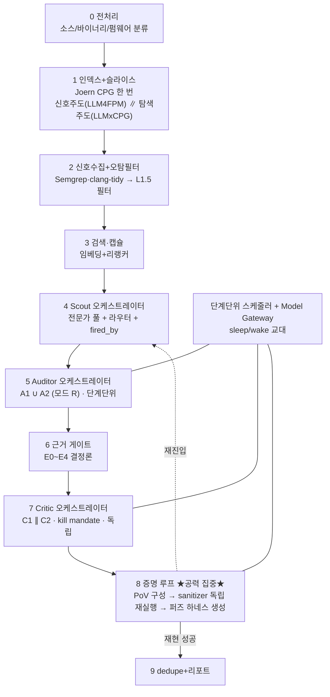

# 이 장비에서 최고 성능을 내는 하네스 아키텍처 — 조사와 제안

조사일 **2026-09-06** · 대상 `origin/main` `ba3c928` · 대상 장비 NVIDIA GB10 (sm_121)

> **이것은 연구 문서다. 실측이 아니다.** 여기 있는 수치의 라벨: **[실측]** = ATOM에서 우리가 잼 ·
> **[출처주장]** = 프론티어 시스템·논문·벤더의 주장(우리 장비 재현 보장 없음) · **[계산]** = 산술 유도 ·
> **[미확인]** = 못 찾음. 설계 판단이 걸린 것은 [build-plan.md](../build-plan.md)와 `docs/decisions/`가
> 정본이고, 이 문서는 **그 판단에 필요한 근거와 한 제안**을 담는다.
>
> **이 제안은 2026-09-06 4인 평의회(Architect·Skeptic·Pragmatist·Critic) 의결을 반영했다** — §8에 원문.
> 세 외부 목소리가 초기 입장(모델 슬롯을 먼저 정한다)을 뒤집었고, 그 반영을 §1이 명시한다.

---

## 0. 목표를 다시 쓴다 — "프론티어급"이 이 장비에서 뜻하는 것

사용자 목표는 **세계 최고의 취약점 발굴 하네스**다. 프론티어 시스템의 실체를 열어 보면 목표를 둘로 갈라야 한다.

| 시스템 | 무엇으로 그 수준인가 [출처주장] |
| --- | --- |
| **Claude Mythos / Glasswing** | 10,000+ high/critical, 1,752건 검증에 **90%+가 true positive**. **핵심은 검증**이다 — 6개 독립 보안 회사가 대조했다. 한 독립 관찰자는 *"버그를 실제로 찾은 것은 Opus 4.6이고 Mythos는 익스플로잇을 만들었다"*고 적었다(위키백과 인용) |
| **GPT-6 Astra** | ExploitBench 100% · 리버스 엔지니어링 88%(1회)·99.2%(4회) · **범위 이탈 0%**(GPT-5.6 Sol은 48.2%). 프론티어 **모델**의 창발 능력 |
| **Microsoft MDASH** | CyberGym 88.45%. 무거운 추론기 + 증류 debater + **별도 SOTA 반대 의견** 패널. **미탐의 65.4%가 prove 단계** — 즉 찾고도 증명에서 놓친다 |
| **Unit 42 NOVA** | 두 달 3,915 프로젝트 14,090건 · 99.4% 미보고. *"모델마다 남이 못 찾은 것을 찾았다."* 확정은 **clean 환경 PoC 재실행 + gatekeeper** |
| **AgentFlow** | 같은 모델로 **하네스만 바꿔 TerminalBench 61%→84%**. 오픈웨이트 Kimi K2.5(1T/**활성 32B**)로 Chrome 0-day 10건 — 단 **192 H100 × 7일** |
| **Sangfor** (CyberGym 1위) | **단일 오픈 모델** 스웜, 97.21%. 다양성이 아니라 **가설 독립 + 탐색/수락 분리 + 차분 검증** |
| **Provos** | 오픈웨이트 GLM 5.1이 18년 된 버그를 **PoC 강제 FSM 하네스**로. *"orchestration problem, not a frontier-model problem."* |

**두 축이 나온다.** ① **깊은 발견**(창발적 추론·익스플로잇 체이닝) — Astra·Mythos가 여기서 앞서고,
그건 **모델**이 정한다. ② **검증된 산출**(오탐 0에 가까운 proven finding) — MDASH·NOVA·Revelio·Sangfor가
여기서 앞서고, 그건 **하네스**가 정한다. **우리가 이 장비에서 움직일 수 있는 축은 ②다.** 활성 3B MoE가
Astra의 창발 추론을 따라잡을 길은 이 하드웨어에 없다(§4가 근거). 그러나 **검증 축은 모델 크기가 아니라
결정론적 도구가 만든다** — Revelio의 오탐 0%는 Critic이 아니라 **sanitizer 독립 재실행**이 냈다.

> **그래서 이 문서의 제안은 "②를 세계 최고로 만들고, ①은 모델이 허락하는 만큼 실측으로 끌어올린다"이다.**
> 이것이 평의회 만장일치였다 — §8.

---

## 1. 평의회가 뒤집은 것 (반영 명시)

초안은 여섯 결정을 **모델 슬롯부터** 정하려 했다. 세 외부 목소리가 그 순서를 반박했고 아래를 채택한다.

| 초안 | 평의회 | 반영 |
| --- | --- | --- |
| 30B 넷 vs 120B를 먼저 고른다 | 1차: **지금 못 고른다** — 120B tok/s가 전부 [출처주장]이고 sm_121 커널이 패치 의존. **2차: 아예 닫는다** — 32K 5서버 OOM [실측] + 구조화 출력 결함 | §4: **닫힘 + 재개 조건 셋.** 30B×4 기준선 유지, 120B는 벤치 대상에서도 뺀다 |
| Auditor 둘, Critic 둘 | Critic: verifier가 없으면 union FP 85%를 못 구한다. Skeptic: 도구가 이미 이기는 자리에 LLM Critic 둘을 세울 이유가 없다 | §3: Critic 합의는 **8단계 우선순위로만**, 승격 안 함. 둘째 Critic 슬롯은 **PoV 실행 에이전트와 메모리를 다툰다** — §4가 그 교환을 명시 |
| 여섯 결정 병렬 | **stage-8이 프론티어와의 진짜 격차다.** MDASH 미탐 65.4%가 prove, Revelio 오탐 0%가 sanitizer에서, 그리고 **E4가 지금 실도구 경로에서 도달 불가**(STATUS.md §5) | §2: 엔지니어링 **1순위를 stage-8 증명 루프**로. Auditor 서사 품질(build-plan L5)은 최하위 그대로 |
| 펌웨어를 소스와 같이 다룬다 | **Critic의 최강 반론:** stage-8·Revelio·FT4 보상이 전부 **빌드 가능·실행 harness**를 전제한다. 킥오프 1순위는 소스·빌드 없는 펌웨어 | §2.3: **증명 강도 사다리**를 타깃 종류별로 갈라 명시. 펌웨어는 E4 천장이 다르다 |

**바뀌지 않은 것.** Auditor 둘을 **합집합 전량(모드 R)으로 먼저** 돌려 공동오답 행렬을 만든다는 판단은
셋 다 지지했다(cascade의 신호가 아직 없다 — [D28](../open-questions/D/D28.md)). FT1을 즉시, FT4를 실행기 뒤로 두는 것도.

---

## 2. 제안 아키텍처 — 검증을 심장에 둔다

[architecture.md](../architecture.md) §2의 0~9단계 좌표를 그대로 쓴다. 바꾸는 것은 **어디에 공력을 넣는가**다.

**핵심 세 문장.** ① 판정은 의견이 아니라 **근거**로 자른다 — 6단계 게이트가 앙상블의 진짜 합산기다.
② `proven`은 **8단계만** 낸다 — Critic 둘이 합의해도 E3까지. ③ 모델은 단계마다 **하나씩 상주**하고
교대한다 — 두 서버 동시 상주가 273 GB/s를 나눠 총량이 안 느는 것을 §4가 근거로 든다.

### 2.1 8단계 증명 루프 — 이 하네스의 본체

Revelio(오탐 0% · CyberGym 재현율 69% · $9.10/건)와 NOVA(clean 재실행 + gatekeeper)와 MDASH(미탐 65.4%가
prove)가 같은 곳을 가리킨다: **검증이 곧 성능이다.** 구성:

1. **PoV 구성 에이전트** — Auditor의 `repro_spec` 초안을 받아 실제 입력·harness를 만든다. Revelio형:
   후보마다 **5회 시도**, 셸·검증·제출 도구만 준다.
2. **Sanitizer 독립 재실행** — 에이전트가 낸 입력을 **하네스가 별도 프로세스에서 다시 돌려**
   ASan/UBSan/MSan 리포트를 **프로그래밍으로** 확인한다. 에이전트의 자기 보고를 믿지 않는다 —
   이것이 오탐 0의 기제다. `Evidence(kind=SANITIZER/CRASH/POC_RUN, ok=True)`가 E4를 연다.
3. **퍼즈 하네스 생성** — 대상 함수에 실행 harness가 없으면 LLM이 만든다(OSS-Fuzz-Gen형, Crash
   Validation Agent가 허위 crash 65% 필터). Big Sleep의 교훈: *"OSS-Fuzz harness가 그 확장을 안 켜서
   퍼징이 놓쳤다"* — **harness 생성이 커버리지의 병목**이다.
4. **재진입** — 8단계가 새 Evidence를 내면 후보를 4단계로 되돌린다. 지금 이 배선이 없다
   ([architecture.md](../architecture.md) §3 ⚠ · [D25](../open-questions/D/D25.md)) — **만들 것이 이 신호다.**

### 2.2 왜 여기인가 — build-plan L5와의 관계

[build-plan.md](../build-plan.md) §3이 **L5(Auditor 서술 품질)를 최하위**로, 이유를 "대역폭에 정면으로 맞는다"로
뒀다. 평의회가 그 위에 근거를 보탰다: **서사는 등급을 못 바꾸고 증명은 바꾼다.** E1(주장)에서 E4(재현)로
가는 유일한 길이 8단계다. 프론티어와의 격차가 "더 좋은 설명"이 아니라 "실행된 증명"이라는 것이
MDASH·Revelio·NOVA 셋의 공통 서술이다.

### 2.3 증명 강도 사다리 — 타깃 종류가 천장을 정한다 (Critic 반영)

Critic의 최강 반론: stage-8은 **빌드 가능·실행 harness**를 전제하는데 킥오프 1순위는 **소스·빌드 없는 펌웨어**다.
숨기지 않고 사다리를 갈라 둔다. **이 표가 §0 규칙의 적용이다 — 못 하는 것을 0으로 두고 사유를 남긴다.**

| 타깃 종류 | 최고 도달 등급 | 8단계가 하는 일 | 왜 그 천장인가 |
| --- | --- | --- | --- |
| 소스 + 빌드 + 테스트 harness (zlib·nlohmann/json) | **E4 proven** | PoV → sanitizer 독립 재실행 | Revelio 전제와 같다. 여기서만 오탐 0이 성립 |
| 소스 · 빌드는 되나 harness 없음 | **E4**(harness 생성 성공 시) / 아니면 **E3** | 퍼즈 harness 생성 → 성공하면 재실행 | OSS-Fuzz-Gen이 이 자리. 생성 실패가 천장을 E3로 내린다 |
| **펌웨어 바이너리 · 소스/빌드 없음** | **E3 상한** [미확인 — 실측 없음] | 에뮬레이션(QEMU) 재현 또는 정적 도달성만. sanitizer 없음 | **stage-8의 오탐 0 기제가 성립하지 않는다.** 이 경로의 E4는 별도 연구다([D9](../open-questions/D/D9.md)) |

> **⚠ 2차 평의회가 이 절을 이 문서의 최우선 리스크로 올렸다.** Critic: *"0·1·8단계가 전부 소스를
> 전제한다 — Joern CPG, `.c/.cpp` 인덱싱, sanitizer 재실행. 킥오프가 말한 「소스도 빌드도 없는 펌웨어
> 바이너리」에 닿는 스테이지가 **하나도 없다.** 10단계를 다 지어도 1차 타깃에 대해 0건이다."*
> **메모리 문제보다 앞선다.** 그리고 같은 목소리가 두 번째를 짚었다 — **인덱서가 헤더를 건너뛴다**
> (`container_tools._INDEX_SUFFIXES`가 `.c`·`.cc`·`.cpp`·`.inc` 넷만 받고 `.h`·`.hpp`는 문법이 있는데도
> 안 넘긴다, [build-plan.md](../build-plan.md) §5). C 취약점이 실제로 사는 자리(매크로 경계값·인라인 함수·
> 구조체 레이아웃)를 **구조적으로 못 본다**. 캡슐이 그 줄을 못 담으면 `Evidence.location`이 채워져도
> 근거가 비고, 게이트는 다시 **구조적으로 거짓인 등급**을 올린다 — [D23](../open-questions/D/D23.md)에서
> 이미 한 번 겪은 실패 형태다. **헤더 인덱싱은 stage-8보다 싸고 같은 축이다.**

**따라 나오는 것.** 첫 실측·첫 파이프라인은 **소스+빌드 타깃**으로 stage-8을 세운다(Critic 우려대로
"안전지대 회피"가 되지 않도록, 펌웨어 경로의 E3 상한을 **같은 run에서 함께 관측**해 격차를 수치로 남긴다).
NVFP4의 롱컨텍스트 절벽(>64K에서 −59% [출처주장])이 펌웨어·대형 코드베이스에 정면으로 걸리므로
([2026-09-04-quantization.md](2026-09-04-quantization.md) §1.1), 펌웨어 경로는 **캡슐이 64K를 넘지 않도록**
슬라이스가 더 공격적이어야 한다 — [2026-09-06-indexer-dual-slicing.md](2026-09-06-indexer-dual-slicing.md) §4-5의 지표다.

---

## 3. 역할별 결합 규칙 (요지 — 상세는 ensemble 문서)

[2026-09-06-ensemble-orchestration.md](2026-09-06-ensemble-orchestration.md)가 근거 전부를 든다. 결론만:

- **Scout**: 투표 아닌 분업. 라우터(정적 신호 CWE 클래스, 모델 호출 0) → top-k 전문가 → `fired_by` 기록.
  오탐 필터(L1.5)가 필수 짝(전문가는 자기 계열 밖에서 오탐을 쏟는다 — F1 0.12~0.19 붕괴).
- **Auditor A1 ∪ A2 (모드 R)**: 합집합으로 전량. 정밀도 비용은 게이트·Critic·도구가 되찾는다.
  cascade(모드 C)는 공동오답 행렬을 본 뒤 — 지금은 cascade 신호(Scout 점수)의 분포조차 없다(D28).
- **Critic C1 ∥ C2**: 반증 임무(kill mandate) · 주장만 입력(Auditor 추론도, 다른 Critic 판정도 안 줌) ·
  단일 라운드 · 2패스(자유 서술 → JSON). 둘의 합의는 **8단계 우선순위**이지 승격이 아니다
  (만장일치 정확도 90.9% · 열 명이 없는 취약점을 승인한 사례).
- **계열 강제**: Auditor 둘 · Critic 둘 · 넷이 서로 다른 제작사 — 그러나 **제작사 라벨은 오류 독립성의
  약한 프록시다**(Nine Judges: 계열당 1명이 오히려 n_eff를 낮췄다). [D59](../open-questions/D/D59.md)가 강제 코드
  부재를 든다 — 코드로 막되 그 강제가 독립성을 보장하지 않음을 함께 적는다.

---

## 4. 모델 슬롯과 메모리 — 120B는 **닫는다**

> **2026-09-06 2차 평의회로 이 절의 판정이 바뀌었다.** 초판은 "실측 전 확정 금지"였다. 2차 평의회
> 만장일치로 **닫힘**이 됐고, **닫는 근거도 바뀌었다** — 산술이 아니라 **실측**이다. 경위는 §8.2.

**판정: 이 하네스에 120B급을 얹지 않는다.** 근거는 아래 순서로 무겁다.

| # | 근거 | 등급 |
| --- | --- | --- |
| 1 | **32K에서 5서버가 안 뜬다** — 2026-09-04에 4개까지 뜨고 5번째가 CUDA OOM으로 죽었다. 120B 상주 구성은 그 5서버의 특수 케이스이고, 큰 쪽으로 특수하다 | **[실측]** |
| 2 | **구조화 출력 결함** — 가장 싼 후보 `gpt-oss-120b`의 Harmony × structured output 결함 둘이 상류에서 `not planned`로 닫혀 있다. 우리 하네스는 **전 역할이 엄격 JSON 스키마**를 요구한다 | [출처주장] |
| 3 | **교대가 성립하지 않는다** — §4.2의 딜레마 | [실측 + 계산] |
| 4 | 활성 파라미터가 5~12B다 — 성공 사례 하한(활성 32B)에 못 미친다. **단 이 근거는 우리 30B-A3B(활성 3B)도 같이 벤다**(§4.1 ⚠) | [출처주장] |

**재개 조건 — 이것이 없으면 닫은 것이 아니라 잊은 것이다.** 아래 중 하나가 성립하면 다시 연다.

- **두 번째 ATOM(ConnectX-7 연결)** — [model-serving.md](../model-serving.md) §7이 이미 그 경로를 든다. 메모리가 두 배가 되면 1번 근거가 사라진다.
- **교대 왕복이 76 GB급에서 1분 미만**으로 실측되는 경우(§4.2 딜레마가 깨지는 경우).
- **엄격 JSON을 만족하는 120B급 후보**가 나오고, 그 후보의 활성 파라미터가 32B 이상인 경우.

### 4.0 초판의 산술 — 남기되 근거로 쓰지 않는다

초판은 아래 산술로 닫으려 했다 **[계산]**: 「120B 항상 상주」 5서버(120B + scout 8B + 임베딩 + 리랭커 +
30B Critic)에서 가장 싼 `gpt-oss-120b`(60 GB)조차 가중치 88.0 GiB + **미규명 격차 14.9 GiB**를 빼면 KV
여유가 **16.8 GiB**인데 5서버 최소 필요가 **17.5 GiB**다. 75~76 GB 후보는 **1.3 GiB**만 남는다.

**2차 평의회가 이 산술을 근거에서 뺐다.** Skeptic·Critic이 같은 지점을 짚었다 — 그 체인이
**14.9 GiB 미규명 격차**(nvidia-smi PID 합 96.07 대 호스트 `사용` 111) 위에 서 있고, 그 격차가
이중계상으로 밝혀지면 16.8이 움직여 판정이 뒤집힌다. **미규명 위에 세운 판정은 §0이 금지하는 종류다.**
그래서 산술은 **방향 확인**으로만 남기고, 닫는 근거는 위 표 1·2번(전부 실측·출처주장)이 진다.

### 4.1 크기가 벽을 넘는가 — 넘지 못한다 [출처주장·계산]

성공한 오픈웨이트 제로데이 사례의 하한은 **활성 파라미터 32B**(Kimi K2.5, 그것도 192 H100 × 7일)다.
우리가 검토한 120B 후보 셋은 **활성 10~12B**다 — Nemotron-3-Super-120B-**A12B**, Qwen3.5-122B-**A10B**
(둘 다 이름에 활성이 박혀 있다), gpt-oss-120b는 **활성 수를 우리가 확인하지 않았다** [미확인].
**총 파라미터 4배가 그 벽을 넘는다는 근거가 없다.**

> **⚠ 이 근거는 대칭이다 — 우리 안도 벤다.** 2차 평의회 Skeptic이 짚었다: *"≥32B 활성이라는 기준을
> 그대로 적용하면 활성 3B인 30B-A3B 감사자도 같이 탈락한다. 120B 논쟁이 이 사실을 가리고 있다."*
> **맞다.** 그래서 이 항목은 「120B를 닫는 근거」로는 4순위이고(§4 표), 진짜로 말하는 것은
> **활성 파라미터 축에서는 30B든 120B든 이 장비에서 그 벽을 못 넘는다**이다. 그 벽을 넘는 길은
> 모델 크기가 아니라 §2의 증명 루프와 §4.4의 학습이라는 것이 이 문서의 중심 주장이고,
> 이 대칭이 그 주장을 **약화가 아니라 강화**한다. 그리고 vLLM DGX Spark 가이드가
120B에 **max-num-seqs 4**를 권한다(*"네 스트림 넘으면 per-token 대역폭 세금이 배칭 이득을 넘어선다"*
[출처주장]) — 배치 이득이 사라져 사실상 직렬 실행이다.

### 4.2 동시 상주는 총량을 안 늘린다 — 그래서 단계 단위 단독 상주 [실측·계산]

30B 배칭 곡선은 캐시 OFF 실측에서 **동시성 16 포화**(21.96→35.23→39.77→39.64 tok/s) **[실측]**. 두 서버를
같은 GPU에 함께 두면 **같은 273 GB/s를 나눈다** — MPS 공동 실행 외부 실측이 메모리 집약 커널 둘에서
**둘 다 2.5배까지 느려진다**고 보고한다 [출처주장, arXiv 2604.22430]. 따라서 **역할 안의 두 모델도, 역할
사이도 순차**로 돈다. 단계 단위 실행이면 교대가 3~5회(후보 단위는 512회) [계산]이고, 잠재우기가 51 GiB를
반환하므로 [실측] 단계마다 **한 모델만 깨어 있게** 할 수 있다.

### 4.3 메모리 배치 — 세 시나리오 [실측 기준 + 계산]

가중치 실측: 30B-A3B NVFP4 **18.63 GiB** · 8B NVFP4 **6.38** · 임베딩 **1.62** · 리랭커 **1.38** [실측, PR #142].

| 시나리오 | 상주(단계별 피크) | 근거 |
| --- | --- | --- |
| **기준선 (30B×4)** | 검색 ~3 GiB → Scout 8B ~6.4 → Auditor A1/A2 교대 각 ~19 → Critic C1/C2 교대 각 ~19 → **PoV 실행기 상주 가능** | 전부 [실측] 또는 §7 그 실측에서 [계산] |
| **혼합 (Auditor만 120B)** | Auditor 단계에서 120B ~60~76 GB 단독, 나머지 단계는 30B급 | 120B tok/s가 [출처주장]이라 미확정 |
| **Critic 슬롯 → PoV 실행기** (Pragmatist·Skeptic 제안) | 둘째 Critic(18.6 GiB)을 빼고 그 자리를 8단계 실행 에이전트에 | 둘째 Critic은 실효 ~1.3표(같은 급이면 상관 0.68). 실행기가 정확도·메모리 둘 다 이긴다 |

**판정 (2차 평의회로 갱신).** 기준선(30B×4)으로 **먼저 배선**한다 — 유일하게 실측된 구성이라 §0을 안
어긴다. **120B 시나리오는 위 §4 표대로 닫혔다** — post-wake 벤치 대상에서도 뺀다(그 측정이 답할 질문이
우리 질문이 아니다, §8.2 Skeptic).

**두 번째 모델 슬롯 자체가 재검토 대상이 됐다.** 2차 평의회에서 Skeptic·Pragmatist가 같은 방향으로 반박했다 —
문헌에서 정밀도를 +10.3pp 회복시킨 것은 **검증자**이지 두 번째 의견이 아니고, **8단계가 바로 그 검증자다.**
5단계 합집합과 7단계 Critic 둘은 그 효과를 **교대 2배·토큰 2배**로 미리 사려는 것이며, 게다가
`critic 제작사 ≠ auditor 제작사`를 강제하는 코드가 없어([D59](../open-questions/D/D59.md)) **그 다양성은
지금 존재조차 미확인**이다. 그래서 순서를 이렇게 둔다:

1. **먼저 단일 Auditor · 단일 Critic으로 8단계를 세운다.** 두 번째 슬롯은 이때 쓰지 않는다.
2. 8단계가 돌기 시작하면 **그것을 채점기로 삼아** 두 번째 Auditor를 켜고 공동오답 행렬을 만든다 —
   8단계가 없으면 그 행렬의 「정답」 칸을 채울 방법이 없었다는 것이 이 순서의 진짜 이유다.
3. 행렬이 「둘이 같은 것을 함께 틀린다」를 보이면 두 번째 슬롯을 **PoV 실행기와 바꾼다**.

### 4.4 학습 — 크기보다 학습이 성능이라면 (사용자 지시 반영)

사용자가 **"LoRA든 파인튜닝이든 최고 성능이면 된다"**고 했다. build-plan §6의 채점 가능 자리에만 붙이는 원칙 위에
평의회가 순서를 못박았다. **학습 장소는 ATOM이 아니다**(aarch64 세금 + 서빙이 메모리를 쓴다, build-plan §6).

| ID | 대상 | 방법 | 채점기 | 우선순위 근거 |
| --- | --- | --- | --- | --- |
| **FT1** | 인덱서 CPGQL 쿼리 생성 | SFT (LoRA) | Joern 파싱 통과 + 정답 줄 포함 | **즉시.** 유일하게 실측된 대폭 개선 — 베이스 유효율 10%→100% [출처주장, LLMxCPG]. 실행기 불필요 |
| **FT4** | PoV 재현 전략 | GRPO (Mastermind형) | **실행 검증 차분 crash** | **stage-8 루프가 reward를 낼 수 있을 때.** 동결 실행기에서 45→60·58.5→71% [출처주장] |
| **FT2** | Scout 전문가 | SFT · JSON | 파이프라인 최종 상태 | Scout 점수 분포 버그(D28)를 고친 뒤 — 안 고치면 학습 대상이 뭔지 모른다 |
| **FT3** | Critic | GRPO | 8단계 도구 결과 | 마지막. 보상이 8단계에서 나온다 |

**NVFP4 베이스에 LoRA가 붙는가는 [미확인]**이다([build-plan.md](../build-plan.md) §9). vLLM은 Blackwell에서
양자화 MoE + LoRA를 지원하기 시작했으나(fused_moe LoRA, 실측 보고 있음 [출처주장]) sm_121·우리 버전에서
확인 안 됐다. FT1 착수 전 이것부터 잰다.

---

## 5. Model Gateway — 교대를 배선하는 자리

[2026-09-04-swap.md](2026-09-04-swap.md) §5~7이 최소 변경 목록과 두 제안(A: 단계 재배열 + `execution.swap`,
C: 부분 상주 + run 분할)을 든다. 이 문서의 제안은 **평의회 반영으로 그 사이**다:

- **먼저 제안 C(외곽 스케줄러)로 배선한다.** Pragmatist: 러너 핵심 1,400줄을 안 건드리고 후보 묶음을 단계별로
  배치하는 외곽만 얹는다. 이유는 swap.md §7 제안 C의 근거 그대로 — CUDA graph 모순·wake 크래시·잠든 서버
  잔류량이 전부 [미확인]이라, 그 위에 러너 중심부를 재작성하면 추정 위에 짓는 것이 된다.
- **교대 훅은 어댑터가 만든 콜러블로 경계를 넘긴다** — `symbols_for`·`counter_for_role`과 같은 모양
  (러너는 `src/adapters/`를 import 하지 않는다, CI가 강제). 새 패턴이 아니다.
- **`execution`·`swap` 키는 스키마가 `extra="forbid"`라 기본값 없이 넣으면 프로필 13개가 로드 실패**한다
  (swap.md §1 정정 6). 전부 선택 필드 + 기본값.
- **in-flight 0일 때만 sleep**(vLLM #28714) · **`--host 127.0.0.1` 유지**(dev mode 관리 엔드포인트 인증 없음) ·
  **`nvidia-smi --query-compute-apps`를 계측기로**(--query-gpu는 이 장비에서 `[N/A]`) — swap.md §8 운영 규칙.

---

## 6. 실행 순서 — 재고 나서 짓는다

[build-plan.md](../build-plan.md) §8이 이미 순서를 뒀고 평의회가 **stage-8을 앞으로** 당겼다. 재정렬:

| # | 무엇 | 왜 이 순서 | 상태 |
| --- | --- | --- | --- |
| 1 | **8단계 증명 루프 배선** — PoV 구성 + sanitizer 독립 재실행 (**소스+빌드 타깃**, 단일 Auditor·단일 Critic) | 프론티어와의 진짜 격차. E4를 처음 도달 가능하게 하고, **그 뒤 모든 항목의 채점기가 된다** | 실도구 E4 미도달(STATUS §5) |
| 2 | **헤더 인덱싱**(`.h`·`.hpp`) | stage-8보다 싸고 같은 축이다 — 캡슐이 매크로 경계값·인라인을 못 담으면 근거가 구조적으로 빈다(§2.3 ⚠) | `.c`·`.cc`·`.cpp`·`.inc` 넷만 |
| 3 | **단계 단위 외곽 스케줄러** — 후보 단위를 단계 배치로 감싼다 | 교대·다중 모델의 전제. 러너 핵심 불변 | 후보 단위(swap 512회) |
| 4 | **후보당 토큰·시간 최초 측정** | [D24](../open-questions/D/D24.md). 3번이 끝나야 잴 수 있고, 이 값 없이는 예산·상한이 전부 관례다 | 미실측 |
| 5 | **둘째 Auditor 투입 + 공동오답 행렬** | **1번이 채점기를 만든 뒤**에만 행렬의 「정답」 칸이 채워진다 | 단일 Auditor |
| 6 | **인덱서 탐색주도(질의형) 추가 + 겹침 행렬** | L1이 가장 큰 레버. FT1 데이터가 여기서 쌓임 | 탐색주도 미배선 |
| 7 | **FT1 → FT4 → FT2 → FT3** | 채점 가능 자리 순. **FT1도 1번 뒤로 갔다** — 쿼리 유효율은 파싱으로 재지만 「좋은 슬라이스」는 8단계가 판정한다 | 미착수 |

**앞선 두 개 (순서 밖).** ⓐ **NVFP4 베이스에 LoRA가 붙는가** [미확인] — FT 전체의 선행이고, 안 되면
재양자화가 먼저다. ⓑ **펌웨어 경로의 E3 상한** — §2.3의 사다리를 실제 타깃으로 확인한다. 두 번째 타깃
종류를 고르기 전에 답이 있어야 한다.

**측정 순서(먼저 재고 짓는다 — build-plan §8 말미).** ① wake 후 첫 추론 bench(CUDA graph 모순 가름,
swap.md §9 — 3번의 전제) → ② 후보당 토큰·시간 → ③ 공동오답 행렬 → ④ Q 쿼리 유효율 → ⑤ S 슬라이스
gold 포함율. **120B·두 서버 공동 실행 벤치는 뺐다** — §4에서 닫힌 시나리오의 측정이다.

---

## 7. 이 제안이 틀릴 수 있는 자리 — 읽는 사람이 알아야 할 것

1. **120B tok/s는 전부 [출처주장]이고 sm_121 커널은 패치 의존이다.** Qwen3.5-122B는 vLLM 패치 15개, nightly가
   필요했다 [출처주장]. 우리 0.27.1에서 뜬다는 보장이 없다 — §4의 "실측 전 확정 금지"가 이것 때문이다.
2. **stage-8의 오탐 0은 소스+빌드 타깃에서만 성립한다**(§2.3). 펌웨어 경로의 E4는 별도 연구이고, 그것을
   지금 "된다"로 적으면 §0 위반이다.
3. **활성 3B가 프론티어 창발 추론을 못 따라잡는다는 것은 [계산·추론]이지 우리 실측이 아니다.** 반증하려면
   30B-A3B가 실제 대상에서 제로데이를 내면 된다 — 문헌에 그 사례가 없을 뿐(§ensemble 6) 우리가 못 낸다는 증명은 아니다.
4. **"검증이 성능"이라는 이 문서의 중심 주장은 남의 시스템(MDASH·Revelio·NOVA) 측정이다.** 우리 장비에서
   stage-8이 재현율을 얼마나 올리는지는 §6 순서 1을 돌려야 나온다.
5. **평의회는 이 대화의 맥락 없이 소집됐다**(anti-anchoring). 그들이 못 본 저장소 사실이 있으면 판단이 바뀐다 —
   그래서 §8에 원문을 남겨 다음 사람이 대조하게 한다.

---

## 8. 평의회 원문 (2026-09-06 · anti-anchoring 소집)

> 세 외부 목소리는 이 대화 이력 없이 **질문과 라벨된 맥락만** 받았다.

**Architect(내 초기 입장, 외부 목소리 읽기 전).** 30B×4를 기준선으로 두고 stage-8과 단계 단위 전환을
1순위로, 120B는 실측 후 재판단. 가장 강한 리스크로 "펌웨어에 빌드 harness가 없어 stage-8 전제가 깨지는 것"을 꼽았다.

**Skeptic.** *"여섯 질문 중 다섯은 순서가 틀렸다. 격차를 만드는 건 모델 수·크기가 아니라 E4가 구조적으로
도달 불가라는 사실이다."* 슬롯 하나·Auditor 하나·Critic 0으로 줄이고 전 공력을 stage-8에. 근거: (1)의 근거가
저장소 규칙상 전부 0 · Revelio 오탐 0은 sanitizer가 만든 것이지 Critic이 아님 · 120B 셋 다 활성 10~12B라 벽
(활성 32B)을 못 넘고 max-num-seqs 4로 배치 이득도 사라짐. 놓칠 것: *"120B로 격차가 준다는 건 착시."*

**Pragmatist.** 러너 핵심(1,400줄)은 안 건드리고 **외곽 단계 스케줄러**만 얹은 뒤 첫 6주를 전부 stage-8에.
30B×4 유지, 120B는 gpt-oss-120b **하나만** post-wake 벤치. mode R 먼저(cascade 임계값이 될 Scout 점수가
고유값 9개·71% 0.0). FT1만 즉시. 놓칠 것: *"둘째 Critic 슬롯(18.6 GiB)을 지우고 PoV 실행 에이전트에 주는 게
정확도·메모리 둘 다 이긴다. 심판을 늘리는 게 아니라 실행기를 넣는 것이 frontier와의 차이."*

**Critic.** *"프런티어 목표는 이 하드웨어·타깃 조합에서 구조적으로 도달 불가."* 계획이 미실측·모순된 두 전제
위에 섰다 — (a) 120B wake 신뢰성(L2 wake는 reload_weights 없이·추론 없이 쟀고 fp8 KV wake 크래시 이슈가
이 장비에 열려 있다), (b) 빌드 가능한 펌웨어(킥오프 1순위가 소스·빌드 없는 바이너리인데 stage-8·Revelio·FT4가
전부 실행 harness를 전제). 놓칠 것: *"양자화 손실 최악 지점이 펌웨어가 필요로 하는 지점이다 — 4비트는
>64K 컨텍스트에서 −59%."*

### 판정

- **합의**: (a) 모델 슬롯은 실측 전 확정 불가 — §0 위반. (b) **stage-8 증명 루프가 프론티어와의 진짜 격차**이고
  엔지니어링 1순위다. (c) Critic 합의는 우선순위이지 승격이 아니다. (d) mode R 먼저, cascade는 행렬 뒤.
  (e) FT1 즉시, FT4는 실행기 뒤. (f) 단계 전환은 러너 핵심을 건드리지 않는 외곽으로.
- **가장 강한 반론(채택)**: Critic의 **펌웨어 전제** — stage-8 전제가 소스+빌드에만 성립한다. §2.3 증명 강도
  사다리로 반영하고, 펌웨어 E3 상한을 같은 run에서 함께 관측해 격차를 수치로 남긴다.
- **전제 점검(Skeptic)**: 질문 자체("여섯을 지금 다 정한다")를 반박했다 — 다섯은 실측 뒤로 미룬다. 채택.
- **권고**: **검증을 심장에 둔 하네스.** 30B×4 기준선으로 stage-8을 먼저 세우고, 120B와 둘째 Critic 슬롯 교환과
  cascade는 공동오답 행렬·post-wake 벤치가 숫자를 낸 뒤 결정한다. 최고 성능은 더 큰 모델이 아니라
  **오탐 0에 수렴하는 증명 루프 + FT1이 여는 슬라이스 정확도**에서 나온다.

---

## 8.2 2차 평의회 (2026-09-06 · 「120B를 얹을 수 있나 · 이 구조를 평가하라」)

1차 평의회가 남긴 「모델 슬롯은 실측 전 확정 불가」를 팀이 되물었다 — *"120B는 얹을 수 없는 구조 아닌가?"*
같은 anti-anchoring 절차로 다시 소집했고, **이 문서의 §4 판정이 바뀌었다.**

**Architect(내 초기 입장).** 산술로 닫는다 — 5서버 구성이 KV 여유 16.8 대 최소 17.5로 실패하고 교대는
wake당 7~9분이다.

**Skeptic.** *"닫는다 — 단 「산술」이 아니라 5서버 OOM 실측 때문에."* 근거: ① 산술 체인의 토대가 14.9 GiB
**미설명 갭**이라 그것이 이중계상이면 판정이 뒤집힌다 — *"실측만으로 닫히는 문에 추정을 끌어오지 말 것"*
② **활성 파라미터 논거는 120B만 죽이지 않는다** — 활성 3B인 우리 Auditor도 같이 벤다 ③ 문헌의 이득은
5·7이 아니라 8과 1에서 나왔다(61→84는 하네스가, 0% FP는 sanitizer가 냈다). 놓칠 것: *"3자 근거는 패치
15개짜리 다른 vLLM의 **단일 모델 전기계 구성**이다. 재봐도 우리 질문에 답이 안 나온다 — 이건 「미실측 0」으로
남길 항목이 아니라 **다른 질문**이다."*

**Pragmatist.** *"지금 닫는다. 「측정 먼저」는 2인 팀의 한 주를 뺄셈 재확인에 쓰는 일이다."* 재개 조건만
한 줄 적고 닫는다. 선행 작업은 딱 둘 — ① 후보 단위 → 단계 단위 루프 ② PoV 생성기 + 하네스 자체 sanitizer
재실행. 놓칠 것: *"정밀도 +10.3pp를 회복시킨 건 **검증자**지 두 번째 의견이 아니다. **8단계가 바로 그
검증자다.** 5단계 UNION과 7단계 2벤더 Critic은 그 효과를 교대 2배·토큰 2배로 미리 사려는 것이고,
`critic 제작사 ≠ auditor 제작사`를 강제하는 코드가 없어 그 다양성은 존재조차 미확인이다.
**120B는 애초에 천장이 아니었다."***

**Critic.** 상주 120B는 닫되 **근거는 산술이 아니라 JSON 결함(`not planned`)과 활성 5~12B**다.
*"제일 먼저 깨지는 건 메모리가 아니라 **타깃 불일치**다."* 0·1·8단계가 전부 소스를 전제하는데 1차 타깃은
소스도 빌드도 없는 펌웨어다. 8이 빠진 파이프라인의 출력은 **반증 불가능한 주장**이고 E0~E4는 거기에 등급만
붙인다. 놓칠 것: *"헤더를 건너뛰는 인덱서는 C 취약점이 실제로 사는 곳을 구조적으로 못 본다."*

### 판정 (2차)

- **합의**: (a) **120B는 닫는다** — 셋 다. (b) **stage-8이 유일한 진짜 천장**이다. (c) 5·7단계의
  **두 번째 모델은 8단계가 서기 전에는 과설계**다.
- **내 입장이 바뀐 자리 (명시)**: 닫는 것은 유지하되 **근거를 산술에서 실측으로 옮겼다.** Skeptic·Critic이
  독립적으로 같은 지점(14.9 GiB 미규명 갭)을 짚었고 그 반박이 옳다 — §4.0이 그 교정이다.
- **가장 강한 반론(채택)**: Critic의 **타깃 불일치**. §2.3을 이 문서의 최우선 리스크로 올리고 헤더 인덱싱을
  stage-8과 같은 축의 선행 작업으로 넣었다.
- **전제 점검(Skeptic)**: 질문 자체를 반박했다 — *"「지금 닫나 / 나중에 재나」로 두면 둘 다 진다"*. 3자 120B
  구성은 우리 파이프라인과 **다른 물건**이라 측정 항목이 아니라 범위 밖이다. 채택.
- **권고**: **단일 Auditor · 단일 Critic으로 stage-8을 먼저 세운다.** 두 번째 슬롯도, 120B도, 질의형
  슬라이서도 그 다음이다 — 8단계가 서야 그것들을 **채점할 방법**이 생기기 때문이다.

---

## 9. 함께 읽나

| 알고 싶은 것 | 문서 |
| --- | --- |
| 인덱서 두 슬라이서 병행 | [2026-09-06-indexer-dual-slicing.md](2026-09-06-indexer-dual-slicing.md) |
| 역할별 모델 둘 결합 근거 | [2026-09-06-ensemble-orchestration.md](2026-09-06-ensemble-orchestration.md) |
| 30B급 후보·벤치마크·양자화 | [2026-09-04-models.md](2026-09-04-models.md) · [2026-09-04-quantization.md](2026-09-04-quantization.md) |
| 교대 배선 최소 변경 | [2026-09-04-swap.md](2026-09-04-swap.md) |
| 앞으로 무엇을 어느 순서로 | [build-plan.md](../build-plan.md) |
| 지금 구조·단계별 책임 | [architecture.md](../architecture.md) |

## 10. 출처

프론티어 시스템·논문·서빙 근거는 위 다섯 연구 문서가 링크째 든다. 이 문서가 새로 인용한 것:

- Anthropic Claude Mythos / Glasswing — [Help Net Security](https://www.helpnetsecurity.com/2026/05/26/anthropic-project-glasswing-update/) · [Wikipedia](https://en.wikipedia.org/wiki/Claude_Mythos)
- OpenAI GPT-6 Astra — [OpenAI](https://openai.com/index/gpt-6-astra/) · [The Hacker News](https://thehackernews.com/2026/09/gpt-6-astra-scores-100-on-exploitbench.html)
- OpenAI Aardvark / Codex Security — [OpenAI](https://openai.com/index/introducing-aardvark/)
- Google Big Sleep / Naptime — [Project Zero](https://projectzero.google/2024/10/from-naptime-to-big-sleep.html)
- XBOW — [platform](https://xbow.com/platform)
- OSS-Fuzz-Gen — [OSS-Fuzz](https://google.github.io/oss-fuzz/research/llms/target_generation/) · HarnessAgent [arXiv 2512.03420](https://arxiv.org/pdf/2512.03420)
- Mastermind (PoV 재현 GRPO) — [arXiv 2607.01764](https://arxiv.org/abs/2607.01764)
- VulnLLM-R (전문 추론 LLM) — [arXiv 2512.07533](https://arxiv.org/abs/2512.07533) · VULPO-4B [arXiv 2511.11896](https://arxiv.org/abs/2511.11896)
- Dual-Loop 재현 — [arXiv 2602.05721](https://arxiv.org/pdf/2602.05721)
- AI Security Policy Should Assess Systems — [arXiv 2605.09504](https://arxiv.org/html/2605.09504v1)
- Hadrian, "the harness is where the product lives" — [hadrian.io](https://hadrian.io/blog/forget-the-frontier-model-the-harness-is-where-the-product-lives)
- vLLM DGX Spark 서빙 가이드 — [vLLM Blog](https://vllm.ai/blog/2026-06-01-vllm-dgx-spark) · gpt-oss-120b·Nemotron·Qwen3.5-122B 커뮤니티 벤치는 NVIDIA Developer Forums / docai.hu
